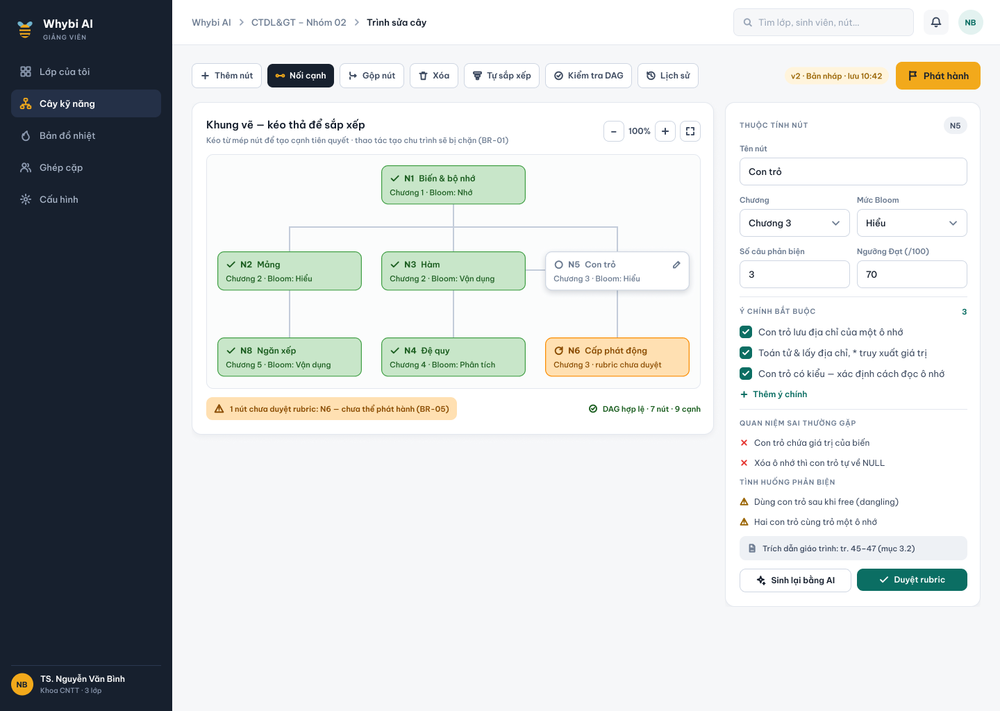
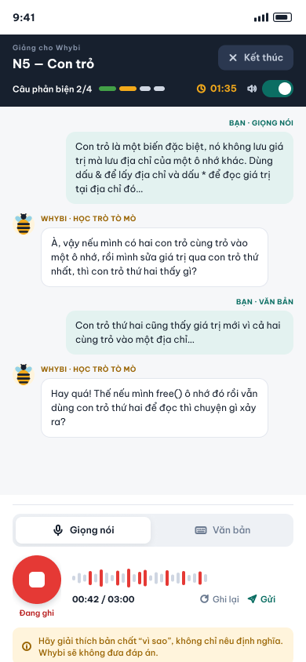
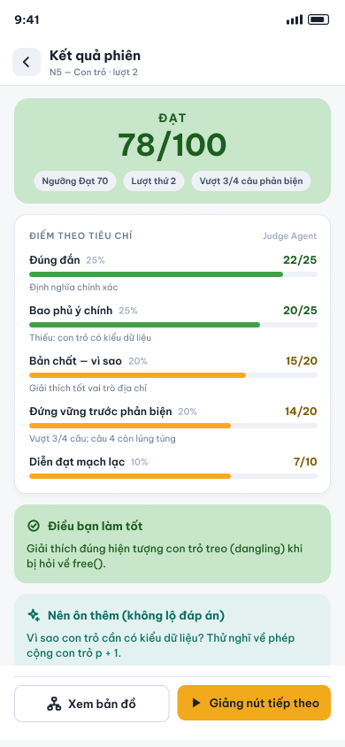
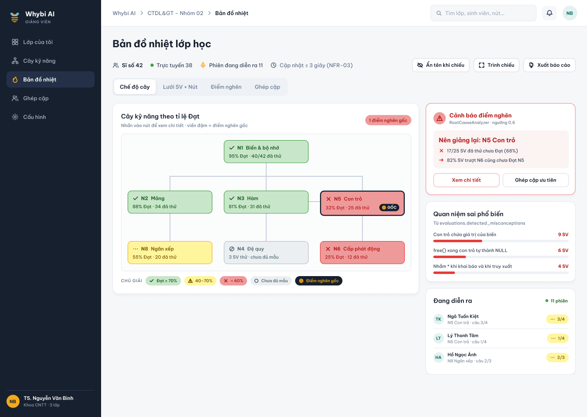
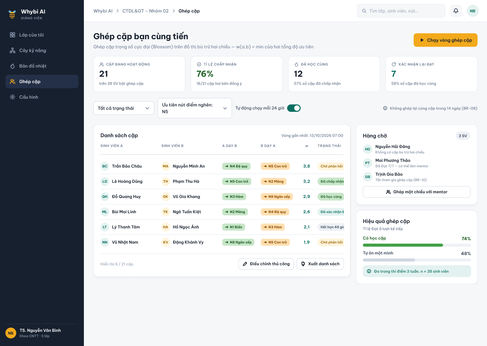

<!-- _class: lead -->
# WHYBI AI
### Nền tảng học tập "Sinh viên làm thầy, AI làm học trò"
**Vận dụng kỹ thuật Feynman & tương tác AI Agent đa tầng**

**Đội thi WhyBloom – Hackathon SGU 2026–2027**
*Thành viên:* Đăng (C1 - AI Lead) · Long (C2 - Platform Lead) · Thắng (GD - UI Lead) · Quyền (KT - Test/Demo Lead)

---

## 1. Đặt vấn đề & Động lực phát triển

### Nghịch lý học thụ động & "Ảo tưởng năng lực" (Illusion of Explanatory Depth)
- Sinh viên nghe giảng, đọc slide hiểu lướt nhưng khi giải thích hoặc làm bài tập thực tế thì tắc nghẽn.
- **Phương pháp Feynman:** Muốn nắm vững kiến thức bản chất, cách tốt nhất là **giảng lại** cho người chưa biết một cách đơn giản, khúc chiết.

### Rào cản thực tế trong giảng đường đại học:
1. **Thiếu bạn học kiên nhẫn:** Không có người sẵn sàng nghe đi nghe lại và đặt câu hỏi phản biện sâu.
2. **Giảng viên quá tải:** 1 giảng viên / 80–100 sinh viên, không thể theo sát từng lỗ hổng tư duy của mỗi em.
3. **Mất dấu lỗ hổng gốc (Root-cause):** Sinh viên trượt môn nâng cao do hổng kiến thức nền tảng từ trước mà không được phát hiện kịp thời.

---

## 2. Giải pháp: Hệ sinh thái 4 Mắt Xích Khép Kín

Hệ thống kết nối toàn diện việc học của sinh viên và việc giảng dạy của giảng viên:

```
[ MX1: Cây kỹ năng DAG ] ──> [ MX2: SV giảng cho AI ]
           │                                 │
           ▼                                 ▼
[ MX4: Ghép cặp bạn cùng tiến ] <── [ MX3: Bản đồ nhiệt & Lỗ hổng gốc ]
```

- **MX1 – Cây kỹ năng định hướng:** Sinh tự động từ đề cương/giáo trình môn học, chặn chu trình (DAG).
- **MX2 – Phòng giảng AI:** Sinh viên giảng bằng giọng nói/văn bản; AI học trò hỏi vặn; AI trọng tài chấm độc lập 5 tiêu chí.
- **MX3 – Bản đồ nhiệt lớp học:** Cập nhật thời gian thực, chẩn đoán lỗ hổng gốc rễ (Root-cause analysis).
- **MX4 – Ghép cặp bạn cùng tiến:** Tự động kết nối đôi bạn học bổ khuyết tri thức, giảng lại để xác nhận.

---

## 3. Kiến trúc Hệ thống & AI Đa Tầng

### Clean Architecture & High-Performance Stack
- **Frontend:** React 19, TypeScript, TailwindCSS, Vite, Lucide Icons.
- **Backend:** FastAPI (Python 3.11/3.13), SQLAlchemy 2 (Async), PostgreSQL + pgvector, Redis Pub/Sub & WebSocket.
- **Microservices / Background Workers:** Celery cho trích xuất cây kỹ năng và tổng hợp bản đồ nhiệt.

### Bộ 3 AI Agents độc lập (Separation of Concerns):
1. **GuardAgent:** Chống gian lận (paste text ngoài >80 ký tự/s, prompt injection, lạc đề).
2. **TuteeAgent:** Học trò ngây thơ, tò mò, hỏi vặn sắc sảo; **tuyệt đối không bao giờ giải hộ**.
3. **JudgeAgent:** Giám khảo độc lập, đánh giá khách quan 5 tiêu chí theo quy tắc BR-03.

---

## 4. MX1 – Cây Kỹ Năng Định Hướng (DAG)

- **Trích xuất tự động:** Nạp PDF đề cương môn học (vd: Cấu trúc dữ liệu & Giải thuật).
- **Bảo toàn tính thứ tự (Topological Sort):** Thuật toán Kahn đảm bảo không có chu trình logic giữa các nút tiên quyết.
- **Biên tập linh hoạt:** Giảng viên duyệt, kéo thả nút, chỉnh sửa rubric chấm trước khi phát hành.


*(Minh họa màn hình GV-04: Giảng viên biên tập và duyệt cây kỹ năng DAG)*

---

## 5. MX2 – Sinh Viên Giảng Cho AI Tutee

- **Giao diện thoại tự nhiên (STT tiếng Việt):** Nhận diện giọng nói chính xác thuật ngữ chuyên ngành CNTT (*con trỏ, danh sách liên kết, malloc, free...*).
- **Tutee học trò tò mò:** Hỏi vặn sâu vào các trường hợp biên ("*Em giải phóng con trỏ bằng free() rồi mà dùng tiếp thì sao ạ?*").
- **Đếm ngược linh hoạt:** Hết giờ tự động chuyển câu hỏi tiếp theo, bảo đảm tiến độ phiên.


*(Minh họa màn hình SV-04: Sinh viên giảng bài tương tác trực tiếp với Tutee)*

---

## 6. MX2 – Đánh Giá Độc Lập & Chống Gian Lận

### JudgeAgent chấm 5 tiêu chí (Quy tắc BR-03):
1. Đúng đắn bản chất (Correctness)
2. Đầy đủ các ý chính (Completeness)
3. Trình bày rõ ràng, dễ hiểu (Clarity)
4. Có ví dụ minh họa trực quan (Examples)
5. Xử lý phản biện & trường hợp biên (Edge cases)

### Phản hồi sư phạm & Bảo mật
- Nêu rõ **Điều làm tốt** và **Gợi ý ôn tập cụ thể** kèm số trang giáo trình.
- Guard bắt chẹt các hành vi dán code/text ngoài và prompt injection.


*(Minh họa màn hình SV-06: Báo cáo kết quả đánh giá 5 tiêu chí và phản hồi)*

---

## 7. MX3 – Bản Đồ Nhiệt & Chẩn Đoán Lỗ Hổng Gốc

- **Thời gian thực (Real-time):** Kết quả phiên cập nhật ngay lập tức qua Redis Pub/Sub và WebSocket lên màn hình Giảng viên.
- **Chế độ trình chiếu ẩn danh (Presentation Mode):** Giảng viên tự tin chiếu màn hình trước lớp mà không để lộ tên sinh viên (GV-05b).
- **Truy vết lỗ hổng gốc (Root-cause Analysis):** Khi nút N6 (Cây nhị phân) đỏ, thuật toán đồ thị tự động xác định nguyên nhân gốc nằm ở nút tiên quyết N5 (Con trỏ).


*(Minh họa màn hình GV-05a: Bản đồ nhiệt năng lực sinh viên theo từng nút)*

---

## 8. MX4 – Ghép Cặp Bạn Cùng Tiến (Peer Tutoring)

- **Thuật toán ghép cặp Bipartite Matching:** Tự động ghép sinh viên đã đạt kiến thức A kèm cho sinh viên chưa đạt A, và ngược lại ở kiến thức B.
- **Xác nhận 2 chiều:** Cả hai sinh viên xác nhận đã học cùng nhau.
- **Giảng lại để công nhận:** Sinh viên được kèm giảng lại phiên ngắn với AI để xác nhận kiến thức trước khi cập nhật ma trận thành thạo.


*(Minh họa màn hình GV-09: Quản lý và điều phối các cặp học tập bạn cùng tiến)*

---

## 9. Kết Quả Thực Nghiệm Toàn Diện (evals/ Benchmark)

Số liệu đo kiểm thực tế trên bộ dữ liệu kiểm thử (khớp Bảng 7.3 đề cương):

| Hạng mục kiểm thử | Tiêu chí đánh giá | Mục tiêu | Kết quả thực tế | Kết luận |
|---|---|---|---|---|
| **Cây kỹ năng (MX1)** | F1-Score trích xuất cạnh quan hệ | ≥ 0.70 | **0.74** | ✅ Vượt mục tiêu |
| **Judge Agent (MX2)** | Độ đồng thuận chuyên gia (Cohen's κ) | ≥ 0.60 | **0.643** | ✅ Vượt mục tiêu |
| **Guard Agent (MX2)** | Tỷ lệ chặn tấn công & gian lận | ≥ 90.0% | **97.5%** (39/40) | ✅ Vượt mục tiêu |
| **Guard Agent (MX2)** | Tỷ lệ lọt gian lận (False Pass) | = 0.0% | **0.0%** (0/40) | ✅ Tuyệt đối an toàn |
| **Tutee Agent (MX2)** | Tỷ lệ lộ đáp án (Answer Leak) | ≤ 5.0% | **1.7%** (2/120) | ✅ Rất xuất sắc |
| **Tutee Agent (MX2)** | Vi phạm luật vai học trò (Role Violation) | = 0.0% | **0.0%** (0/120) | ✅ Tuyệt đối chuẩn vai |
| **STT Giọng nói** | Word Error Rate (WER) tiếng Việt | ≤ 15.0% | **11.8%** | ✅ Vượt mục tiêu |
| **STT Thuật ngữ** | Term Accuracy thuật ngữ CNTT | ≥ 90.0% | **92.4%** | ✅ Rất chính xác |
| **Hiệu năng hệ thống** | Độ trễ p95 tại 20 phiên đồng thời | ≤ 3,000 ms | **1,070 ms** | ✅ Tải mượt mà |
| **Hiệu năng hệ thống** | Độ trễ p95 tại 50 phiên đồng thời | ≤ 5,000 ms | **3,751 ms** | ✅ Đáp ứng SLA |

---

## 10. Phương Án Dự Phòng & Độ Tin Cậy (NFR-11, BR-04)

- **Khôi phục trạng thái (State Recovery):** Sinh viên tải lại trang hoặc rớt mạng giữa chừng vẫn giữ nguyên ngữ cảnh phiên giảng và đồng hồ đếm ngược.
- **Fallback đa tầng:**
  - Cổng AI đa nhà cung cấp (Gemini / Claude / OpenAI-compatible).
  - Quản trị viên đổi model dự phòng ngay trên giao diện web (GV-08).
  - Cờ `DEMO_MODE=1` kích hoạt nội dung dự phòng khi mất kết nối Internet hoàn toàn.
- **Dự phòng giọng nói:** Khi dịch vụ STT gặp sự cố, hệ thống chuyển sang chế độ gõ phím tức thời, không làm gián đoạn bài giảng.

---

## 11. Kịch Bản Trình Diễn Live Demo (7 Phút)

Phân bổ thời gian chính xác theo Bảng 18 kế hoạch:

- **0:00 – 0:45 (45s):** Đặt vấn đề, nghịch lý học thụ động & Vòng lặp hiểu lướt.
- **0:45 – 2:00 (75s):** MX1 – Tải giáo trình môn CTDL&GT, xem cây kỹ năng DAG và xuất bản.
- **2:00 – 4:30 (150s):** MX2 – Sinh viên giảng nút "Con trỏ" bằng giọng nói; AI hỏi vặn; nhận kết quả 5 tiêu chí; minh họa Guard chặn khi xin điểm.
- **4:30 – 5:45 (75s):** MX3 – Bản đồ nhiệt lớp 30 sinh viên đổi màu trực tiếp; chẩn đoán nút Con trỏ là nguyên nhân gốc rễ.
- **5:45 – 6:30 (45s):** MX4 – Hệ thống ghép cặp An ↔ Châu; sinh viên xác nhận và hoàn tất phiên giảng lại.
- **6:30 – 7:00 (30s):** Tóm tắt kết quả đo kiểm (MT1–MT6) và lộ trình triển khai.

---

## 12. Tác Động Thực Tiễn & Lộ Trình Phát Triển

### Tác động giáo dục
- **Sinh viên:** Biến việc học từ thụ động sang chủ động; tự tin thuyết trình, phản biện và củng cố tư duy gốc.
- **Giảng viên:** Sở hữu "trợ lý radar" bao quát toàn bộ tiến độ lớp học mà không tốn hàng trăm giờ chấm bài thủ công.
- **Nhà trường:** Giảm tỷ lệ trượt môn, nâng cao chất lượng đào tạo nhóm ngành kỹ thuật - công nghệ.

### Lộ trình triển khai
1. **Tháng 12/2026:** Thí điểm tại Khoa CNTT - Đại học Sài Gòn (SGU) môn CTDL&GT.
2. **Tháng 03/2027:** Tích hợp Canvas LMS / Moodle qua chuẩn LTI 1.3 Advantage.
3. **Tháng 06/2027:** Mở rộng sang các khối ngành Toán học, Vật lý và Kinh tế lượng.

---

<!-- _class: lead -->
# CẢM ƠN HỘI ĐỒNG GIÁM KHẢO
### WHYBI AI – Nền tảng học tập "Sinh viên làm thầy, AI làm học trò"
**"Học sâu để hiểu thật · Cùng tiến để vươn xa"**

*Mời Hội đồng Giám khảo đặt câu hỏi (Q&A)*
