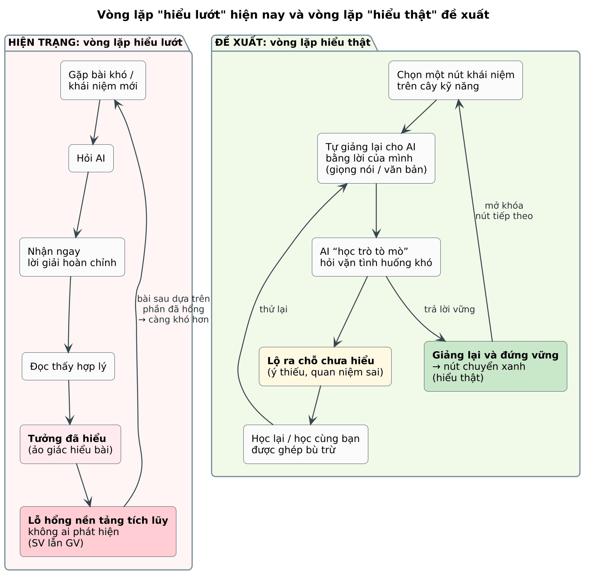
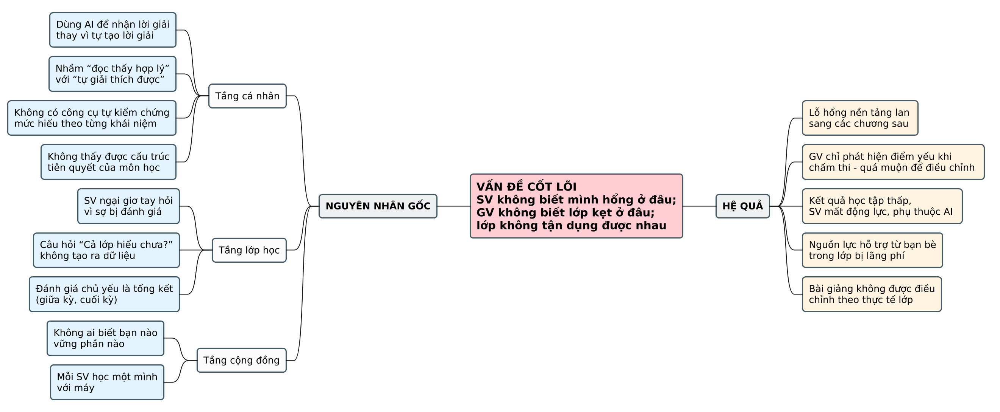
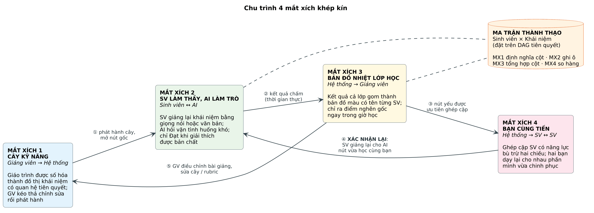

# CHƯƠNG 1. TỔNG QUAN ĐỀ TÀI

## 1.1 Bối cảnh và thực trạng

### 1.1.1 Thói quen dùng AI giải bài hộ và “ảo giác hiểu bài”

- Khi gặp bài khó, sinh viên (SV) ngày càng có xu hướng hỏi các công cụ AI tạo sinh và nhận ngay một lời giải hoàn chỉnh.
- Lời giải trơn tru khiến người đọc thấy “hợp lý”, từ đó tin rằng mình đã hiểu. Tuy nhiên thấy một lời giải hợp lý khác hẳn với tự tạo ra và tự giải thích được lời giải.
- Hiện tượng này được khoa học nhận thức gọi là ảo giác hiểu biết sâu (illusion of explanatory depth): người học đánh giá quá cao mức hiểu của mình cho tới khi bị yêu cầu tự giải thích chi tiết (trình bày ở mục 2.1.1).
- Hệ quả: SV “hiểu lướt”, chỉ phát hiện lỗ hổng khi làm bài kiểm tra – lúc đã muộn.

### 1.1.2 Tính xếp chồng của kiến thức trong các môn kỹ thuật

- Kiến thức các môn kỹ thuật được xây theo bậc thang: không thể hiểu Cây nhị phân nếu chưa hiểu Danh sách liên kết, và không thể hiểu Danh sách liên kết nếu chưa hiểu Con trỏ.
- Một lỗ hổng ở nền tảng sẽ lan sang mọi phần phụ thuộc phía sau; SV thường chỉ thấy “phần sau khó quá” mà không biết gốc rễ nằm ở đâu.
- Cấu trúc tiên quyết này hoàn toàn có thể biểu diễn bằng một đồ thị có hướng – cơ sở cho Mắt xích 1 (cây kỹ năng).

### 1.1.3 Khoảng trống tương tác trong lớp học

- SV ngại giơ tay hỏi vì sợ bị đánh giá; câu hỏi “Cả lớp hiểu chưa?” của giảng viên (GV) thường chỉ nhận lại sự im lặng.
- Đánh giá chủ yếu mang tính tổng kết (giữa kỳ, cuối kỳ), nên GV biết lớp yếu ở đâu khi đã quá muộn để điều chỉnh bài giảng.
- Mỗi SV tự loay hoay một mình, trong khi ngay trong lớp có bạn vững đúng phần mình đang yếu – nguồn lực này không được tận dụng.

Nguồn: [`01_h1_1.puml`](../../diagrams/01_h1_1.puml)
*Hình 1.1. Vòng lặp “hiểu lướt” hiện nay và vòng lặp “hiểu thật” đề xuất*

## 1.2 Phát biểu bài toán

### 1.2.1 Phát biểu tổng quát

Xây dựng một hệ thống học tập lấy khả năng giảng lại một khái niệm và bảo vệ nó trước các câu hỏi phản biện làm thước đo “đã hiểu”, sau đó tổng hợp thước đo này theo cấu trúc tiên quyết của môn học để: (i) SV biết chính xác mình còn hổng ở khái niệm nào và hổng từ gốc nào; (ii) GV thấy được điểm nghẽn của lớp ngay trong giờ học, kèm danh sách SV đang kẹt; (iii) hệ thống ghép các SV có năng lực bù trừ để dạy lại cho nhau.

### 1.2.2 Phân rã vấn đề theo ba tầng

*Bảng 1.1. Phân rã vấn đề theo ba tầng*

| Tầng | Biểu hiện | Nguyên nhân gốc | Hệ quả | Mắt xích xử lý |
|---|---|---|---|---|
| Cá nhân SV | Đọc lời giải của AI thấy hợp lý, tưởng đã hiểu | Nhầm “nhận ra lời giải” với “tự giải thích được”; không có công cụ tự kiểm chứng | Lỗ hổng nền tảng tích lũy, SV không biết mình hổng ở đâu | MX1 + MX2 |
| Lớp học | “Cả lớp hiểu chưa?” → im lặng | Rào cản tâm lý khi hỏi; đánh giá chủ yếu là tổng kết | GV phát hiện điểm yếu quá muộn | MX3 |
| Cộng đồng | Mỗi SV tự học một mình với máy | Không ai biết bạn nào vững phần nào | Nguồn lực hỗ trợ từ bạn bè bị lãng phí | MX4 |

Nguồn: [`02_h1_2.puml`](../../diagrams/02_h1_2.puml)
*Hình 1.2. Cây vấn đề (Problem Tree): nguyên nhân gốc – vấn đề cốt lõi – hệ quả*

### 1.2.3 Ba câu hỏi hệ thống phải trả lời

- Với SV: Mình hổng ở khái niệm nào, và lỗ hổng đó bắt nguồn từ khái niệm tiên quyết nào?
- Với GV: Ngay lúc này, lớp đang kẹt ở đâu, những SV nào đang kẹt, và nên giảng lại phần nào?
- Với lớp học: Ai có thể giúp ai, ở đúng khái niệm nào, sao cho cả hai bên cùng được lợi?

### 1.2.4 Mô hình hóa thành bài toán kỹ thuật

Cả bốn mắt xích cùng xoay quanh một cấu trúc dữ liệu chung: ma trận thành thạo M[Sinh viên × Khái niệm] đặt trên đồ thị tiên quyết có hướng không chu trình (DAG). Mắt xích 1 định nghĩa các cột và quan hệ giữa chúng; Mắt xích 2 ghi giá trị vào từng ô; Mắt xích 3 tổng hợp theo cột; Mắt xích 4 so sánh các hàng (minh họa ở Hình 5.8). Ma trận này là trục xuyên suốt của toàn bộ tài liệu.
*Bảng 1.2. Bốn bài toán con và thách thức kỹ thuật*

| Mắt xích | Đầu vào | Đầu ra | Thách thức kỹ thuật chính |
|---|---|---|---|
| MX1 – Cây kỹ năng | Giáo trình / đề cương (PDF, DOCX) | DAG khái niệm + rubric từng nút, đã được GV duyệt | Trích khái niệm đúng độ mịn; suy luận quan hệ tiên quyết; loại chu trình và cạnh thừa; GV chỉnh sửa; quản lý phiên bản |
| MX2 – Giảng lại cho AI | Lời giải thích (giọng nói hoặc văn bản) cho một nút | Kết luận Đạt / Chưa đạt, điểm theo tiêu chí, ý còn thiếu, quan niệm sai | AI hỏi đúng chỗ yếu nhưng không giảng hộ; chấm nhất quán; nhận dạng giọng nói tiếng Việt lẫn thuật ngữ; chống gian lận và jailbreak |
| MX3 – Bản đồ nhiệt | Toàn bộ ma trận của lớp | Màu và chỉ số từng nút, lưới SV × Nút có tên, cảnh báo điểm nghẽn gốc | Cập nhật thời gian thực; tách “chưa thử” khỏi “chưa đạt”; truy vết nguyên nhân gốc theo quan hệ tiên quyết |
| MX4 – Ghép cặp | Các hàng của ma trận | Danh sách cặp + nút mỗi bạn dạy cho bạn kia | Bù trừ hai chiều; tối ưu cho cả lớp; xử lý SV lẻ; khép vòng bằng xác nhận lại |

## 1.3 Ý tưởng giải pháp: “Sinh viên làm thầy, AI làm học trò”

### 1.3.1 Triết lý đảo vai

Thay vì để AI làm thầy giải bài hộ, hệ thống lật ngược vai trò: SV làm thầy, AI làm học trò. Cách tốt nhất để biết mình có thật sự hiểu hay không là thử giảng lại cho người khác; một “học trò” tò mò, không dễ dãi gật đầu và liên tục hỏi vặn vào các tình huống khó sẽ buộc SV phải hiểu bản chất.

### 1.3.2 Chu trình 4 mắt xích khép kín

- Biến môn học thành bản đồ (MX1): GV tải giáo trình lên, hệ thống vẽ “cây kỹ năng” thể hiện quan hệ tiên quyết; GV kéo thả chỉnh sửa rồi phát hành cho lớp.
- SV giảng bài cho AI (MX2): SV chọn một khái niệm, giải thích bằng giọng nói hoặc văn bản; AI đóng vai học trò tò mò và hỏi vặn; chỉ khi giải thích được bản chất và đứng vững trước phản biện, SV mới được tính là Đạt.
- GV thấy ngay lớp đang kẹt ở đâu (MX3): kết quả cả lớp gom thành bản đồ màu, kèm lưới hiển thị tên từng SV và cảnh báo điểm nghẽn gốc.
- Ghép đôi bạn cùng tiến (MX4): hệ thống tìm các cặp có năng lực bù trừ hai chiều để dạy lại cho nhau.
- Khép vòng: sau khi học cặp, SV giảng lại cho AI để xác nhận; bản đồ nhiệt đổi màu; GV điều chỉnh bài giảng hoặc cây kỹ năng.

Nguồn: [`03_h1_3.puml`](../../diagrams/03_h1_3.puml)
*Hình 1.3. Chu trình 4 mắt xích khép kín (có bước xác nhận lại sau khi học cặp)*

### 1.3.3 Giá trị mang lại cho từng bên

*Bảng 1.3. Giá trị mang lại cho từng bên liên quan*

| Bên liên quan | Hiện trạng | Khi có hệ thống |
|---|---|---|
| Sinh viên | Hiểu lướt, không biết mình hổng ở đâu, học một mình | Hiểu thật qua giảng lại; biết chính xác nút còn hổng và nút gốc; có bạn học bù trừ |
| Giảng viên | Chỉ biết lớp yếu khi chấm thi; không có dữ liệu trong giờ học | Thấy điểm nghẽn ngay trong tiết; biết SV nào đang kẹt; có gợi ý nút cần giảng lại |
| Lớp học / Khoa | Cá nhân học rời rạc với máy | Văn hóa dạy – học lẫn nhau; dữ liệu quan niệm sai phổ biến để cải tiến giáo trình |

## 1.4 Mục tiêu

### 1.4.1 Mục tiêu tổng quát

Xây dựng nền tảng web giúp SV chuyển từ “hiểu lướt” sang “hiểu thật” thông qua cơ chế giảng lại cho AI, đồng thời cung cấp cho GV “đôi mắt” nhìn vào mức hiểu của cả lớp theo thời gian thực và kết nối các SV có năng lực bù trừ.

### 1.4.2 Mục tiêu cụ thể và chỉ số đo

*Bảng 1.4. Mục tiêu cụ thể và chỉ tiêu đề xuất (điều chỉnh sau thử nghiệm)*

| Mã | Mục tiêu | Chỉ số đo | Chỉ tiêu đề xuất |
|---|---|---|---|
| MT1 | Sinh cây kỹ năng tự động từ giáo trình | F1 của nút và cạnh so với cây do GV chỉnh; thời gian sinh | F1 cạnh ≥ 0,70; ≤ 3 phút cho đề cương ~30 trang |
| MT2 | Phiên giảng lại mượt bằng giọng nói và văn bản | Độ trễ p95 mỗi lượt AI; độ trễ STT | ≤ 5 giây (văn bản); ≤ 8 giây (giọng nói 60 giây) |
| MT3 | Chấm “hiểu bản chất” đáng tin cậy | Cohen’s kappa giữa AI và người chấm | κ ≥ 0,60 |
| MT4 | Chống gian lận và tấn công prompt | Tỉ lệ kịch bản tấn công bị chặn | ≥ 90% |
| MT5 | Bản đồ nhiệt thời gian thực | Thời gian từ khi có kết quả đến khi GV thấy | ≤ 3 giây |
| MT6 | Ghép cặp hiệu quả | Tỉ lệ cặp được xác nhận (≥ 1 bên Đạt sau học cặp) | ≥ 50% (đo trong thí điểm) |

## 1.5 Đối tượng, phạm vi và giới hạn

### 1.5.1 Đối tượng người dùng

- Sinh viên: người học các môn kỹ thuật có cấu trúc tiên quyết rõ (CTDL&GT, Lập trình, Hệ điều hành, Mạng máy tính…).
- Giảng viên: người phụ trách lớp học phần, sở hữu giáo trình và chịu trách nhiệm duyệt cây kỹ năng, rubric.
- Quản trị viên: quản lý tài khoản, môn học, cấu hình nhà cung cấp AI và hạn mức sử dụng.

### 1.5.2 Phạm vi chức năng

*Bảng 1.5. Phạm vi chức năng của phiên bản Hackathon (MVP)*

| Trong phạm vi | Ngoài phạm vi (hướng phát triển) |
|---|---|
| • Môn kỹ thuật khối CNTT, giao diện tiếng Việt / • Tải giáo trình PDF/DOCX, sinh cây kỹ năng, trình sửa kéo thả, quản lý phiên bản / • Phiên giảng lại bằng giọng nói và văn bản, đọc câu hỏi bằng TTS (tùy chọn) / • Chấm theo rubric, phản hồi không lộ đáp án / • Bản đồ nhiệt thời gian thực, lưới SV × Nút hiển thị tên SV, truy vết điểm nghẽn gốc / • Ghép cặp bù trừ, xác nhận lại / • Ứng dụng web chạy trên máy tính và điện thoại | • Thay thế điểm chính thức của GV / • Tích hợp LMS (Moodle), SSO của trường / • Ứng dụng di động riêng (native) / • Ôn tập ngắt quãng (spaced repetition) / • Môn học không có cấu trúc tiên quyết rõ / • Phân tích cảm xúc / sinh trắc qua giọng nói |

### 1.5.3 Giả định và ràng buộc

- Có kết nối Internet ổn định trong lớp; thiết bị của SV có micro (khi dùng chế độ giọng nói).
- Sử dụng dịch vụ LLM / STT qua API (có hạn mức); có phương án mô hình dự phòng.
- GV sẵn sàng dành thời gian duyệt cây và rubric trước khi phát hành.
- Giáo trình đầu vào là tài liệu số hoặc bản quét đủ rõ để OCR.
- Thời gian phát triển giới hạn theo lịch Hackathon; ưu tiên tính năng chứng minh được chu trình 4 mắt xích.

## 1.6 Điểm mới và tính phù hợp với Hackathon

- Đảo vai AI: AI là học trò cần được dạy (teachable agent dựa trên LLM), không phải gia sư giải hộ.
- Đo “hiểu bản chất” bằng phản biện có rubric: kết luận Đạt dựa trên tiêu chí rõ ràng do GV duyệt, có tác tử chấm độc lập.
- Dữ liệu lớp học thời gian thực: biến hàng trăm phiên giảng lại thành bản đồ nhiệt và cảnh báo điểm nghẽn gốc.
- Ghép cặp tối ưu toàn lớp: dùng bài toán ghép cặp trọng số cực đại, bắt buộc bù trừ hai chiều, có bước xác nhận lại.
- Đa phương thức: giảng bằng giọng nói hoặc văn bản; giọng nói vừa tự nhiên vừa giảm gian lận dán lời giải.
- Khả thi trong Hackathon: ngăn xếp công nghệ mã nguồn mở, kiến trúc mô-đun, kịch bản demo 7 phút (Hình 7.2).

## 1.7 Bố cục tài liệu

- Chương 1 – Tổng quan đề tài; Chương 2 – Cơ sở lý thuyết và công nghệ; Chương 3 – Phân tích yêu cầu;
- Chương 4 – Phân tích hệ thống (UML); Chương 5 – Thiết kế hệ thống; Chương 6 – Thiết kế lõi AI và thuật toán;
- Chương 7 – Cài đặt, kiểm thử và đánh giá; Chương 8 – Kết luận và hướng phát triển; Tài liệu tham khảo; Phụ lục.
