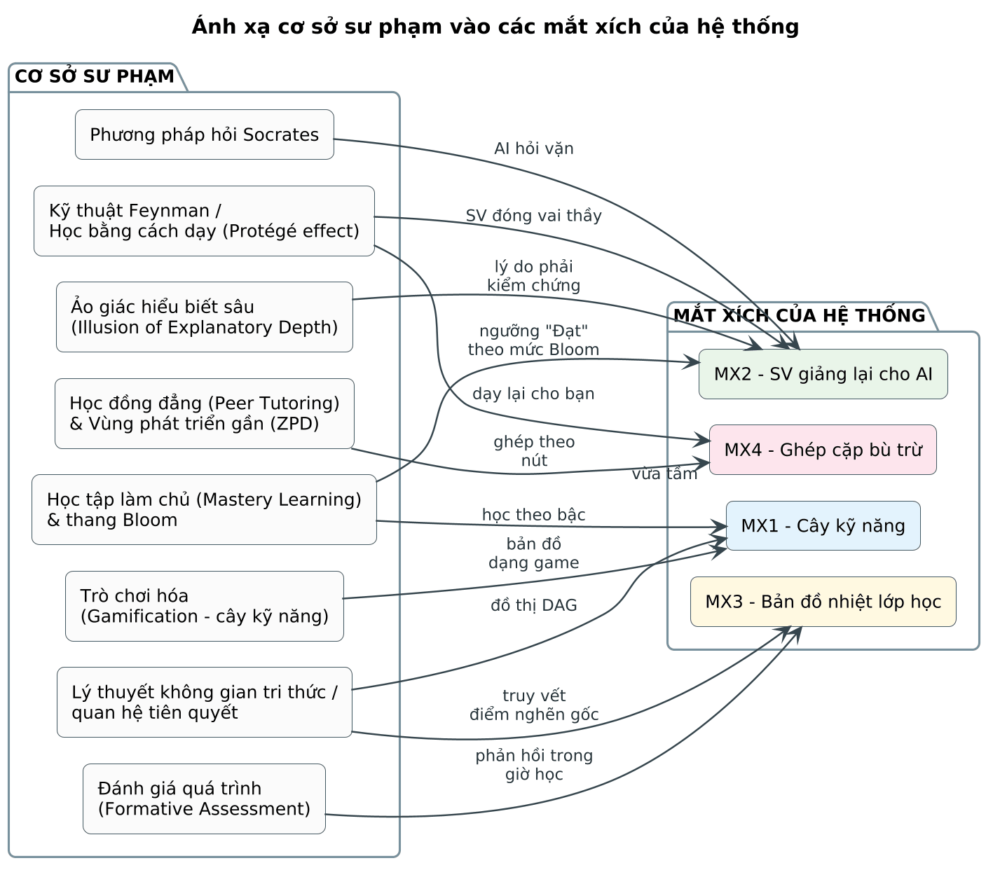
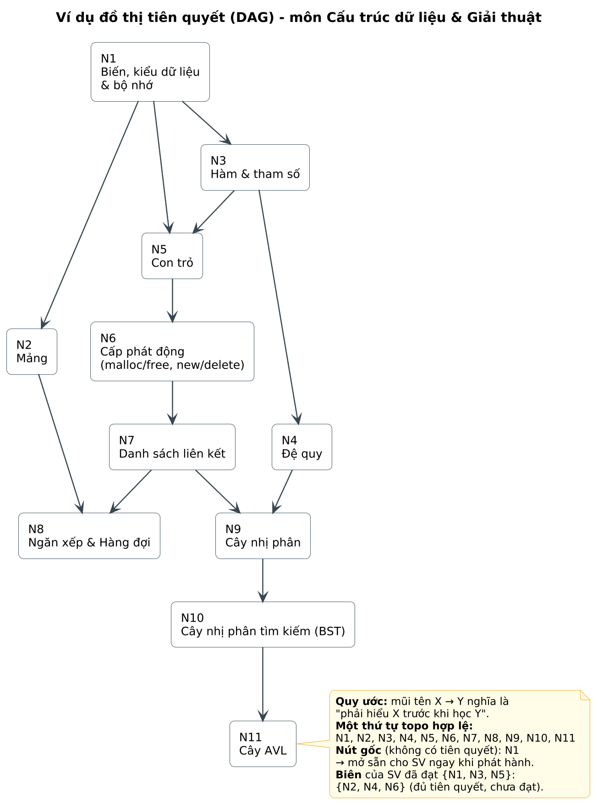
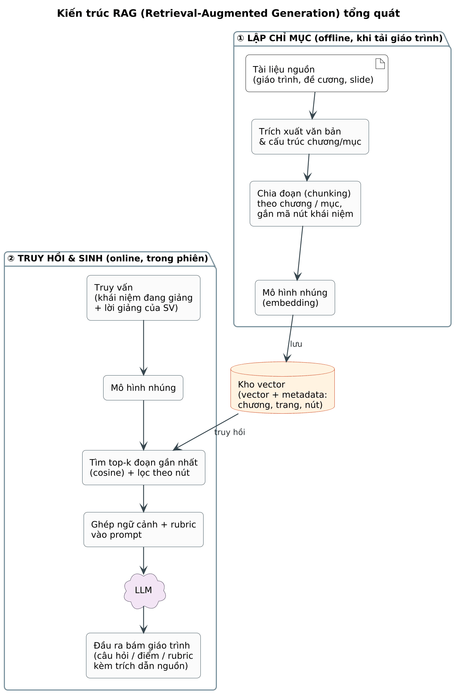
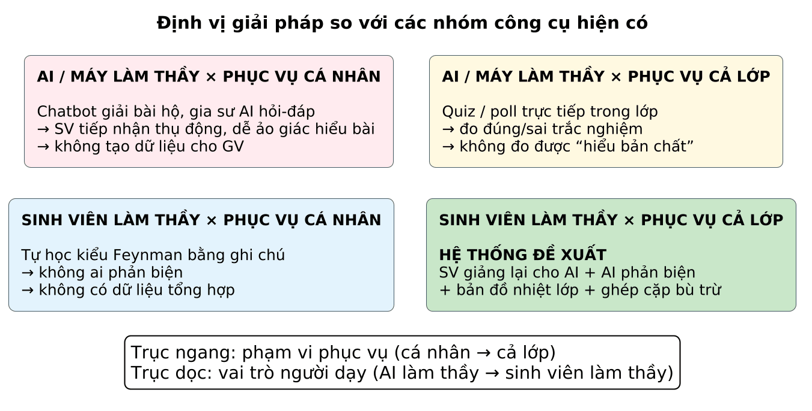

# CHƯƠNG 2. CƠ SỞ LÝ THUYẾT VÀ CÔNG NGHỆ

## 2.1 Cơ sở sư phạm

### 2.1.1 Ảo giác hiểu biết sâu (Illusion of Explanatory Depth)

- Nội dung: người học tin rằng mình hiểu một cơ chế chi tiết hơn thực tế; niềm tin này sụp đổ khi phải tự giải thích từng bước [1].
- Liên hệ: là lý do cốt lõi để hệ thống bắt SV tự giải thích thay vì đọc lời giải → Mắt xích 2.

### 2.1.2 Kỹ thuật Feynman và học bằng cách dạy (Learning by Teaching)

- Kỹ thuật Feynman: giải thích khái niệm bằng ngôn ngữ đơn giản như dạy cho người mới, phát hiện chỗ chưa hiểu, quay lại học và đơn giản hóa.
- Học bằng cách dạy / chuẩn bị để dạy giúp tổ chức kiến thức tốt hơn [2], [3]; “hiệu ứng người được bảo trợ” (protégé effect) khi dạy một tác tử máy [4].
- Liên hệ: SV đóng vai thầy trong phiên giảng lại; SV dạy lại cho bạn trong ghép cặp.

### 2.1.3 Phương pháp đặt câu hỏi Socrates

- Dẫn dắt bằng chuỗi câu hỏi buộc người học làm rõ giả định, xem xét hệ quả, đối diện phản ví dụ.
- Liên hệ: chiến lược câu hỏi của tác tử học trò (ý thiếu → quan niệm sai → tình huống biên → chuyển giao), mục 6.2.4.

### 2.1.4 Học tập làm chủ (Mastery Learning) và thang Bloom

- Học tập làm chủ: chỉ chuyển sang nội dung mới khi đã đạt mức thành thạo nội dung tiên quyết [5].
- Thang Bloom (bản sửa đổi): Nhớ – Hiểu – Áp dụng – Phân tích – Đánh giá – Sáng tạo [6]; dùng để gán mức kỳ vọng cho từng nút và leo thang độ khó câu hỏi.
- Liên hệ: quy tắc “mở khóa nút khi đạt hết tiên quyết” (BR-02) và ngưỡng Đạt theo mức Bloom.

### 2.1.5 Đánh giá quá trình (Formative Assessment)

- Đánh giá diễn ra trong quá trình học để điều chỉnh việc dạy và học, khác với đánh giá tổng kết [7].
- Liên hệ: bản đồ nhiệt là công cụ đánh giá quá trình theo thời gian thực cho GV (Mắt xích 3).

### 2.1.6 Học đồng đẳng và vùng phát triển gần (ZPD)

- Học đồng đẳng (peer tutoring) mang lại lợi ích cho cả người dạy và người học [8].
- Vùng phát triển gần: nội dung vừa tầm – người học chưa tự làm được nhưng làm được khi có hỗ trợ [9].
- Liên hệ: chỉ ghép nội dung thuộc “Biên” của người học (đã đạt đủ tiên quyết) – mục 6.6.2.

### 2.1.7 Lý thuyết không gian tri thức và cấu trúc tiên quyết

- Không gian tri thức mô tả tập trạng thái tri thức khả dĩ dựa trên quan hệ tiên quyết giữa các mục kiến thức [10].
- Liên hệ: biểu diễn môn học bằng DAG; khái niệm “Biên” (outer fringe) của một trạng thái tri thức.

Nguồn: [`04_h2_1.puml`](../../diagrams/04_h2_1.puml)
*Hình 2.1. Ánh xạ cơ sở sư phạm vào các mắt xích của hệ thống*

## 2.2 Cơ sở công nghệ

### 2.2.1 Đồ thị có hướng không chu trình, sắp xếp topo và rút gọn bắc cầu

- DAG: đồ thị có hướng không chứa chu trình – mô hình tự nhiên cho quan hệ “phải học X trước Y”.
- Sắp xếp topo (thuật toán Kahn hoặc DFS, O(V + E)): sinh thứ tự học hợp lệ, xếp tầng hiển thị cây.
- Phát hiện chu trình bằng DFS ba màu; rút gọn bắc cầu: bỏ cạnh A→C nếu đã có đường A→…→C [11].
- Khái niệm “Biên” của SV: tập nút chưa Đạt nhưng mọi tiên quyết đã Đạt.

Nguồn: [`05_h2_2.puml`](../../diagrams/05_h2_2.puml)
*Hình 2.2. Ví dụ đồ thị tiên quyết (DAG) cho môn Cấu trúc dữ liệu và Giải thuật*

### 2.2.2 Mô hình ngôn ngữ lớn và tác tử nhập vai

- LLM: sinh văn bản theo ngữ cảnh; dùng cho trích xuất khái niệm, sinh câu hỏi, chấm điểm.
- Kỹ thuật prompt: vai trò (system), ràng buộc hành vi, ví dụ mẫu, đầu ra có cấu trúc theo JSON Schema.
- Kiến trúc đa tác tử: tách nhiệm vụ hỏi (Tutee), chấm (Judge) và kiểm duyệt (Guard) để giảm thiên lệch và dễ kiểm soát.

### 2.2.3 Truy hồi tăng cường (RAG)

- RAG kết hợp truy hồi đoạn tài liệu liên quan với sinh văn bản để giảm “bịa” và bám nguồn [12].
- Áp dụng: câu hỏi và rubric bám sát giáo trình của GV, có trích dẫn trang.

Nguồn: [`06_h2_3.puml`](../../diagrams/06_h2_3.puml)
*Hình 2.3. Kiến trúc RAG tổng quát và cách áp dụng trong hệ thống*

### 2.2.4 LLM-as-a-Judge và chấm theo rubric

- Dùng LLM làm người chấm theo tiêu chí; cho kết quả gần với đánh giá của con người nhưng tồn tại thiên lệch vị trí, độ dài, tự ưu ái [13].
- Biện pháp: rubric có mô tả mức điểm, nhiệt độ 0, chấm nhiều lần và đảo thứ tự, tách khỏi tác tử hội thoại, hiệu chỉnh với GV (mục 6.3).

### 2.2.5 Nhận dạng và tổng hợp giọng nói tiếng Việt

- Mô hình STT đa ngôn ngữ huấn luyện quy mô lớn (ví dụ Whisper [14]) hoặc dịch vụ đám mây.
- Thách thức: tiếng Việt xen thuật ngữ tiếng Anh (pointer, malloc, NULL), tiếng ồn lớp học, giọng vùng miền.
- Giải pháp: gợi ý thuật ngữ theo nút, chuẩn hóa bằng so khớp mờ, ngưỡng độ tin cậy và bước xác nhận bản chép lời (mục 6.4).

### 2.2.6 Bài toán ghép cặp trọng số cực đại

- Cho đồ thị vô hướng có trọng số, tìm tập cạnh không chung đỉnh có tổng trọng số lớn nhất.
- Thuật toán Blossom của Edmonds giải trên đồ thị tổng quát, độ phức tạp O(V³) [15]; có sẵn trong thư viện NetworkX.

### 2.2.7 Giao tiếp thời gian thực

- WebSocket (RFC 6455) cho kênh hai chiều giữa máy chủ và bảng điều khiển của GV.
- Redis Pub/Sub làm bus sự kiện nội bộ giữa các dịch vụ và worker.

## 2.3 Khảo sát các giải pháp hiện có

Ghi chú: Thông tin về các sản phẩm dưới đây cần được kiểm tra lại tại thời điểm hoàn thiện tài liệu (tính năng có thể đã thay đổi).

### 2.3.1 Gia sư AI dạng hỏi – đáp

- Chatbot đa năng (ChatGPT, Gemini…) và gia sư AI theo kiểu Socratic dành cho giáo dục.
- Điểm mạnh: phản hồi tức thì; điểm yếu: AI vẫn là “thầy”, SV dễ nhận lời giải; không tạo dữ liệu lớp học cho GV.

### 2.3.2 Tác tử có thể dạy được (Teachable Agents)

- Ví dụ: Betty’s Brain – SV dạy một tác tử bằng cách xây bản đồ khái niệm [4].
- Khác biệt: hệ thống đề xuất dùng LLM để nhận lời giảng tự do bằng giọng nói/văn bản, sinh câu hỏi phản biện theo giáo trình của GV và tổng hợp dữ liệu cả lớp.

### 2.3.3 Công cụ phản hồi trong lớp học

- Kahoot!, Mentimeter, Google Forms: thu phản hồi nhanh bằng trắc nghiệm / bình chọn.
- Hạn chế: đo đúng/sai, không đo khả năng giải thích; không gắn với cấu trúc tiên quyết.

### 2.3.4 Nền tảng học theo lộ trình / cây kỹ năng

- Khan Academy (mastery), Duolingo (lộ trình dạng game).
- Hạn chế: nội dung soạn sẵn bởi nền tảng, không sinh từ giáo trình riêng của GV; không có ghép cặp trong lớp.

### 2.3.5 So sánh và khoảng trống

*Bảng 2.1. So sánh hệ thống đề xuất với các nhóm giải pháp hiện có*

| Tiêu chí | Gia sư AI | Teachable agent | Quiz / poll | Lộ trình / cây | Đề xuất |
|---|---|---|---|---|---|
| SV phải tự giải thích | ✗ | ✓ | ✗ | ✗ | ✓ |
| Câu hỏi phản biện theo ngữ cảnh | △ | △ | ✗ | ✗ | ✓ |
| Nhập bằng giọng nói | △ | ✗ | ✗ | △ | ✓ |
| Sinh cấu trúc từ giáo trình của GV | ✗ | ✗ | ✗ | ✗ | ✓ |
| Dữ liệu lớp thời gian thực cho GV | ✗ | △ | ✓ | △ | ✓ |
| Chỉ ra điểm nghẽn gốc | ✗ | ✗ | ✗ | ✗ | ✓ |
| Ghép cặp học đồng đẳng | ✗ | ✗ | ✗ | ✗ | ✓ |

Ký hiệu: ✓ có; △ một phần / tùy sản phẩm; ✗ không có. Cần kiểm chứng lại từng ô trước khi nộp.

Nguồn: [`07_h2_4.puml`](../../diagrams/07_h2_4.puml)
*Hình 2.4. Định vị giải pháp theo hai trục: vai trò người dạy và phạm vi phục vụ*
