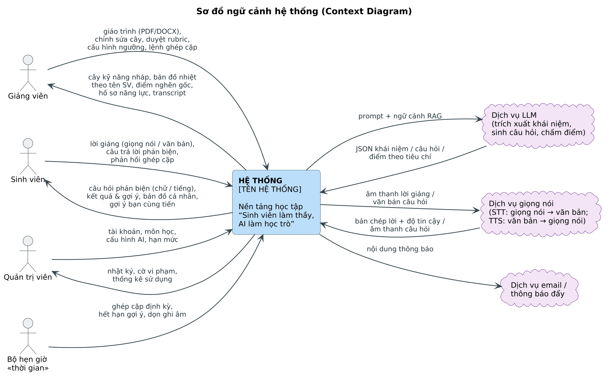
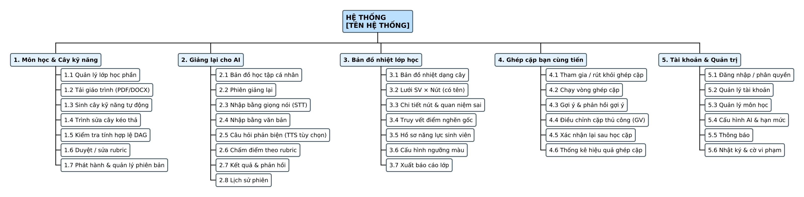

# CHƯƠNG 3. PHÂN TÍCH YÊU CẦU

## 3.1 Tác nhân và ngữ cảnh hệ thống

*Bảng 3.1. Danh sách tác nhân*

| Tác nhân | Loại | Mô tả | Mục tiêu chính |
|---|---|---|---|
| Giảng viên | Chính | Người phụ trách lớp học phần, sở hữu giáo trình | Có cây kỹ năng đúng ý; thấy điểm nghẽn của lớp; can thiệp kịp thời |
| Sinh viên | Chính | Người học, thành viên lớp học phần | Hiểu thật từng khái niệm; biết mình hổng ở đâu; có bạn học bù trừ |
| Quản trị viên | Chính | Quản lý hệ thống | Hệ thống vận hành ổn định, an toàn, trong hạn mức chi phí |
| Dịch vụ LLM | Hệ thống ngoài | Mô hình ngôn ngữ lớn qua API | Trích xuất, sinh câu hỏi, chấm điểm, nhúng văn bản |
| Dịch vụ STT/TTS | Hệ thống ngoài | Nhận dạng và tổng hợp giọng nói | Chuyển lời giảng thành văn bản; đọc câu hỏi |
| Bộ hẹn giờ | Thời gian | Tác vụ định kỳ | Ghép cặp định kỳ, hết hạn gợi ý, dọn ghi âm |

Nguồn: [`08_h3_1.puml`](../../diagrams/08_h3_1.puml)
*Hình 3.1. Sơ đồ ngữ cảnh hệ thống (Context Diagram)*

## 3.2 Sơ đồ phân rã chức năng

Nguồn: [`09_h3_2.puml`](../../diagrams/09_h3_2.puml)
*Hình 3.2. Sơ đồ phân rã chức năng (BFD)*

## 3.3 Yêu cầu chức năng

Mức ưu tiên: M – bắt buộc cho bản Hackathon (MVP); S – nên có; C – mở rộng nếu còn thời gian.

### 3.3.1 Phân hệ Môn học và Cây kỹ năng

*Bảng 3.2. Yêu cầu chức năng – Môn học và Cây kỹ năng*

| Mã | Yêu cầu | Tác nhân | Ưu tiên |
|---|---|---|---|
| FR-SK-01 | Tạo lớp học phần (môn, học kỳ, tên lớp), sinh mã tham gia 8 ký tự | GV | M |
| FR-SK-02 | Tải giáo trình PDF/DOCX ≤ 20 MB; kiểm tra định dạng, dung lượng | GV | M |
| FR-SK-03 | Phân tích tài liệu nền, hiển thị tiến độ theo thời gian thực; OCR khi là bản quét | Hệ thống | M |
| FR-SK-04 | Trích xuất khái niệm, suy luận quan hệ tiên quyết, đảm bảo kết quả là DAG | Hệ thống | M |
| FR-SK-05 | Sinh rubric cho từng nút: ý chính bắt buộc, quan niệm sai, tình huống phản biện, mức Bloom, có trích dẫn trang | Hệ thống | M |
| FR-SK-06 | Trình sửa cây kéo thả: thêm / sửa / xóa / gộp nút, thêm / xóa cạnh, tự sắp xếp | GV | M |
| FR-SK-07 | Chặn thao tác tạo chu trình và chỉ rõ đường đi của chu trình | Hệ thống | M |
| FR-SK-08 | Duyệt / sửa rubric; sinh lại rubric bằng AI cho một nút | GV | M |
| FR-SK-09 | Phát hành cây; khởi tạo hoặc di chuyển trạng thái thành thạo của SV | GV, Hệ thống | M |
| FR-SK-10 | Quản lý phiên bản: xem lịch sử, so sánh, khôi phục | GV | S |

### 3.3.2 Phân hệ Giảng lại cho AI

*Bảng 3.3. Yêu cầu chức năng – Giảng lại cho AI*

| Mã | Yêu cầu | Tác nhân | Ưu tiên |
|---|---|---|---|
| FR-TB-01 | Tham gia lớp bằng mã; xem bản đồ học tập cá nhân dạng cây với trạng thái từng nút | SV | M |
| FR-TB-02 | Chỉ cho phép bắt đầu phiên ở nút Sẵn sàng / Chưa đạt / Cần xác nhận lại; chỉ ra tiên quyết còn thiếu | Hệ thống | M |
| FR-TB-03 | AI mở đầu phiên với vai “học trò tò mò”, nhờ SV giảng khái niệm | Hệ thống | M |
| FR-TB-04 | Nhập lời giảng và câu trả lời bằng văn bản; ghi nhận sự kiện dán và tốc độ gõ | SV | M |
| FR-TB-05 | Nhập bằng giọng nói: ghi âm ≤ 3 phút, hiển thị dạng sóng, ghi lại, dừng | SV | M |
| FR-TB-06 | Chuyển giọng nói thành văn bản tiếng Việt, chuẩn hóa thuật ngữ của nút | Hệ thống | M |
| FR-TB-07 | Khi độ tin cậy STT thấp: hiển thị bản chép lời, gạch chân từ không chắc, cho SV chỉnh nhỏ; ghi nhận chỉnh sửa | SV, Hệ thống | M |
| FR-TB-08 | Sinh 3–5 câu hỏi phản biện theo chiến lược (ý thiếu, quan niệm sai, tình huống biên, chuyển giao) | Hệ thống | M |
| FR-TB-09 | Không giảng hộ, không lộ đáp án trong câu hỏi (kiểm duyệt đầu ra) | Hệ thống | M |
| FR-TB-10 | Đọc câu hỏi bằng giọng nói (TTS) khi SV bật | SV | S |
| FR-TB-11 | Đếm giờ trả lời mỗi câu; ghi nhận hết giờ | Hệ thống | S |
| FR-TB-12 | Chấm theo 5 tiêu chí bằng tác tử chấm độc lập; áp dụng quy tắc Đạt (BR-03) | Hệ thống | M |
| FR-TB-13 | Hiển thị kết quả: điểm từng tiêu chí, điểm mạnh, gợi ý ôn dạng câu hỏi gợi mở, trang giáo trình | SV | M |
| FR-TB-14 | Phát hiện và gắn cờ jailbreak / lạc đề / dán bất thường | Hệ thống | M |
| FR-TB-15 | Xem lịch sử phiên của bản thân, nghe lại ghi âm | SV | C |

### 3.3.3 Phân hệ Bản đồ nhiệt lớp học

*Bảng 3.4. Yêu cầu chức năng – Bản đồ nhiệt lớp học*

| Mã | Yêu cầu | Tác nhân | Ưu tiên |
|---|---|---|---|
| FR-HM-01 | Hiển thị bản đồ nhiệt dạng cây: màu mỗi nút theo tỉ lệ Đạt / đã thử | GV | M |
| FR-HM-02 | Hiển thị lưới SV × Nút có tên và MSSV, trạng thái từng ô, tiến độ mỗi SV | GV | M |
| FR-HM-03 | Cập nhật thời gian thực (≤ 3 giây) qua WebSocket | Hệ thống | M |
| FR-HM-04 | Phân biệt “chưa đủ mẫu / chưa thử” với “chưa đạt” | Hệ thống | M |
| FR-HM-05 | Truy vết và cảnh báo điểm nghẽn gốc (“Nên giảng lại X”) | Hệ thống | M |
| FR-HM-06 | Xem chi tiết nút: SV theo trạng thái (có tên), quan niệm sai phổ biến, nút gốc | GV | M |
| FR-HM-07 | Xem hồ sơ năng lực một SV và transcript / ghi âm các phiên | GV | S |
| FR-HM-08 | Cấu hình ngưỡng màu, cỡ mẫu tối thiểu, ngưỡng Đạt, số câu phản biện | GV | S |
| FR-HM-09 | Lọc, tìm theo tên; chế độ trình chiếu (có tùy chọn ẩn tên khi chiếu lên màn hình lớp) | GV | S |
| FR-HM-10 | Xuất báo cáo lớp CSV / PDF | GV | C |

### 3.3.4 Phân hệ Ghép cặp bạn cùng tiến

*Bảng 3.5. Yêu cầu chức năng – Ghép cặp bạn cùng tiến*

| Mã | Yêu cầu | Tác nhân | Ưu tiên |
|---|---|---|---|
| FR-PM-01 | SV bật / tắt tham gia ghép cặp | SV | M |
| FR-PM-02 | Chạy vòng ghép cặp theo lệnh GV hoặc định kỳ | GV, Bộ hẹn giờ | M |
| FR-PM-03 | Tính trọng số bù trừ hai chiều, giải ghép cặp trọng số cực đại | Hệ thống | M |
| FR-PM-04 | Ưu tiên nút đang là điểm nghẽn của lớp | Hệ thống | S |
| FR-PM-05 | Gửi gợi ý (hạn 48 giờ): bạn ghép, nút mình dạy, nút mình học; chấp nhận / từ chối | SV | M |
| FR-PM-06 | Đánh dấu “Đã học cùng”; mở yêu cầu xác nhận lại | SV, Hệ thống | M |
| FR-PM-07 | Xác nhận lại bằng phiên giảng lại; cập nhật trạng thái cặp | SV, Hệ thống | M |
| FR-PM-08 | GV xem danh sách cặp, điều chỉnh thủ công, thống kê hiệu quả | GV | S |

### 3.3.5 Phân hệ Tài khoản và Quản trị

*Bảng 3.6. Yêu cầu chức năng – Tài khoản và Quản trị*

| Mã | Yêu cầu | Tác nhân | Ưu tiên |
|---|---|---|---|
| FR-AD-01 | Đăng nhập / đăng xuất, quên mật khẩu, cập nhật hồ sơ | Mọi người dùng | M |
| FR-AD-02 | Phân quyền theo vai trò (GV, SV, QTV) | Hệ thống | M |
| FR-AD-03 | Quản lý tài khoản; nhập danh sách SV từ CSV | QTV | S |
| FR-AD-04 | Quản lý danh mục môn học | QTV | S |
| FR-AD-05 | Cấu hình nhà cung cấp LLM, STT, TTS; mô hình dự phòng | QTV | M |
| FR-AD-06 | Đặt hạn mức token / phút ghi âm theo lớp, theo SV | QTV | S |
| FR-AD-07 | Xem nhật ký, xử lý cờ vi phạm | QTV | S |
| FR-AD-08 | Thông báo trong ứng dụng và email | Hệ thống | S |

## 3.4 Yêu cầu phi chức năng

*Bảng 3.7. Yêu cầu phi chức năng và chỉ tiêu đề xuất*

| Mã | Nhóm | Yêu cầu | Chỉ tiêu đề xuất | Cách đo |
|---|---|---|---|---|
| NFR-01 | Hiệu năng | Độ trễ mỗi lượt câu hỏi của AI (văn bản) | p95 ≤ 5 giây | Log thời gian, k6 |
| NFR-02 | Hiệu năng | Độ trễ chép lời cho 60 giây âm thanh | p95 ≤ 4 giây | Log SpeechService |
| NFR-03 | Hiệu năng | Độ trễ cập nhật bản đồ nhiệt | ≤ 3 giây | Đo đầu–cuối |
| NFR-04 | Khả năng chịu tải | Số phiên giảng lại đồng thời trong một tiết học | ≥ 100 phiên, lỗi < 1% | Kiểm thử tải |
| NFR-05 | Độ tin cậy AI | Đồng thuận giữa Judge và người chấm | Cohen’s κ ≥ 0,60 | Bộ dữ liệu hiệu chỉnh |
| NFR-06 | Độ tin cậy AI | Câu hỏi không lộ đáp án | ≥ 95% câu hỏi qua Guard ở lần sinh đầu | Thống kê Guard |
| NFR-07 | Bảo mật | Mã hóa đường truyền, băm mật khẩu, JWT hết hạn | TLS 1.2+, Argon2/bcrypt, JWT 30 phút | Kiểm tra cấu hình |
| NFR-08 | Quyền riêng tư | Chỉ GV phụ trách lớp xem dữ liệu có tên SV; SV không xem được kết quả của nhau | 100% API kiểm tra quyền | Kiểm thử phân quyền |
| NFR-09 | Quyền riêng tư | Lưu ghi âm có thời hạn, xin đồng ý trước khi ghi | Mặc định 30 ngày, cấu hình được | Tác vụ dọn dẹp |
| NFR-10 | Khả dụng | Sẵn sàng trong giờ học | ≥ 99% trong khung giờ học | Giám sát uptime |
| NFR-11 | Trải nghiệm | Dùng tốt trên điện thoại; tối đa 3 thao tác để bắt đầu một phiên | Responsive ≥ 360 px | Kiểm thử người dùng |
| NFR-12 | Tiếp cận | Màu luôn kèm biểu tượng (người mù màu đỏ–lục) | 100% trạng thái có biểu tượng | Rà soát giao diện |
| NFR-13 | Chi phí | Giới hạn chi phí AI mỗi phiên | ≤ ngân sách token cấu hình | Báo cáo hạn mức |
| NFR-14 | Bảo trì | Đổi nhà cung cấp LLM/STT không sửa nghiệp vụ | Qua lớp Adapter | Rà soát mã |

## 3.5 Quy tắc nghiệp vụ

*Bảng 3.8. Quy tắc nghiệp vụ*

| Mã | Nội dung quy tắc | Áp dụng ở |
|---|---|---|
| BR-01 | Các cạnh tiên quyết của một phiên bản cây phải tạo thành DAG (không có chu trình, không có cạnh tự trỏ). | UC06, UC07, UC09 |
| BR-02 | Một nút chỉ chuyển từ Khóa sang Sẵn sàng khi mọi nút tiên quyết của nó đã Đạt. | Mastery |
| BR-03 | Đạt ⇔ tổng điểm ≥ ngưỡng Đạt (mặc định 70/100) ∧ nêu đủ mọi ý chính bắt buộc ∧ vượt ≥ k câu phản biện (mặc định 2/3) ∧ không còn quan niệm sai nghiêm trọng chưa được sửa. | UC19 |
| BR-04 | Tác tử học trò không được giải thích hộ, không đưa đáp án, không khen khi lập luận chưa chặt. | UC19 |
| BR-05 | Phát hành chỉ hợp lệ khi: cây là DAG, có ≥ 1 nút gốc, mọi nút có rubric đã duyệt. | UC09 |
| BR-06 | Màu nút: XÁM nếu số SV đã thử < cỡ mẫu tối thiểu (mặc định 5); XANH nếu tỉ lệ Đạt ≥ 70%; VÀNG nếu 40–70%; ĐỎ nếu < 40%. GV cấu hình được. | UC10 |
| BR-07 | Bản đồ nhiệt hiển thị tên SV cho GV phụ trách lớp; SV chỉ xem kết quả của bản thân và thông tin tối thiểu của bạn được ghép. SV được thông báo rõ khi tham gia lớp. | UC10–UC12 |
| BR-08 | Chỉ ghép cặp khi bù trừ hai chiều (w > 0); không ghép lại cùng một cặp trong N ngày (mặc định 14). | UC15 |
| BR-09 | Gợi ý ghép cặp hết hạn sau 48 giờ nếu chưa đủ hai bên chấp nhận; hạn xác nhận lại 7 ngày sau khi học cùng. | UC22, UC23 |
| BR-10 | SV có quyền từ chối gợi ý và tắt tham gia ghép cặp bất kỳ lúc nào. | UC21, UC22 |
| BR-11 | Sau khi Chưa đạt, SV có thể thử lại sau thời gian chờ (mặc định 10 phút) để khuyến khích ôn lại. | UC19 |
| BR-12 | Phiên có ≥ 3 lần vi phạm bị gắn cờ; kết quả chỉ được tính khi GV cho phép. | UC19, UC27 |
| BR-13 | Ghi âm chỉ được thực hiện khi SV đã đồng ý; tự xóa sau thời hạn lưu trữ. | UC19, UC26 |
| BR-14 | Khi phát hành phiên bản mới: nút đổi rubric chuyển Đạt → Cần xác nhận lại; nút có tiên quyết mới chưa Đạt chuyển về Khóa. | UC09 |

## 3.6 Ma trận truy vết yêu cầu – Use Case

*Bảng 3.9. Truy vết nhóm yêu cầu chức năng tới Use Case*

| Nhóm yêu cầu | Use Case | Biểu đồ minh họa |
|---|---|---|
| FR-SK-01 … 10 | UC04, UC05, UC06, UC07, UC08, UC09 | Hình 4.4, Hình 4.9, Hình 4.16 |
| FR-TB-01 … 15 | UC17, UC18, UC19, UC20 | Hình 4.5, Hình 4.11, Hình 4.19 |
| FR-HM-01 … 10 | UC10, UC11, UC12, UC13, UC14, UC16 | Hình 4.6, Hình 4.13, Hình 4.22 |
| FR-PM-01 … 08 | UC15, UC21, UC22, UC23 | Hình 4.7, Hình 4.14, Hình 4.23 |
| FR-AD-01 … 08 | UC01, UC02, UC03, UC24 … UC27 | Hình 4.8 |
