# CHƯƠNG 4. PHÂN TÍCH HỆ THỐNG

## 4.1 Mô hình nghiệp vụ tổng thể

Chu trình nghiệp vụ được tách thành hai biểu đồ hoạt động có làn bơi: (a) giai đoạn thiết lập môn học do GV khởi động (Mắt xích 1) và (b) vòng lặp học tập lặp lại liên tục trong học kỳ (Mắt xích 2, 3, 4). Điểm nối (A) cho biết vòng lặp (b) chỉ bắt đầu sau khi cây đã phát hành.
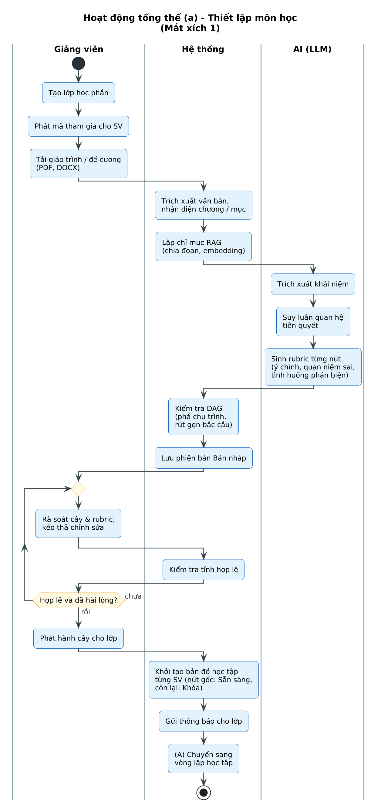
Nguồn: [`10_act_overall_a.puml`](../../diagrams/10_act_overall_a.puml)
*Hình 4.1. Biểu đồ hoạt động tổng thể (a) – thiết lập môn học*

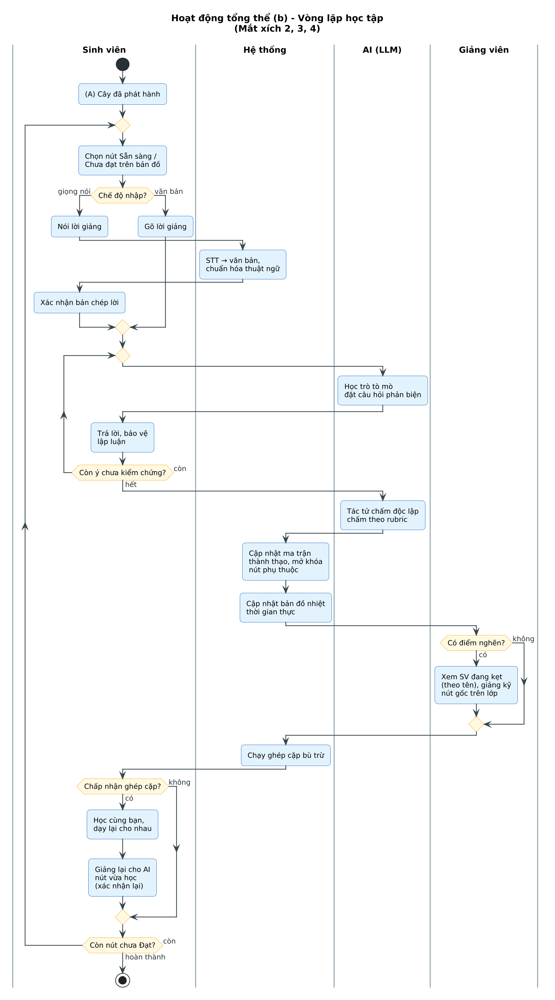
Nguồn: [`11_act_overall_b.puml`](../../diagrams/11_act_overall_b.puml)
*Hình 4.2. Biểu đồ hoạt động tổng thể (b) – vòng lặp học tập*

## 4.2 Biểu đồ Use Case

### 4.2.1 Danh sách Use Case

*Bảng 4.1. Danh sách Use Case*

| Mã | Tên Use Case | Tác nhân | Mô tả ngắn |
|---|---|---|---|
| UC01 | Đăng nhập / Đăng xuất | Mọi người dùng | Xác thực, cấp JWT theo vai trò |
| UC02 | Cập nhật hồ sơ | Mọi người dùng | Sửa thông tin cá nhân, đổi mật khẩu |
| UC03 | Xem thông báo | Mọi người dùng | Thông báo phát hành cây, gợi ý ghép cặp, cảnh báo |
| UC04 | Quản lý lớp học phần | GV | Tạo lớp, tạo lại mã tham gia, lưu trữ lớp |
| UC05 | Tải giáo trình lên | GV | Tải PDF/DOCX làm đầu vào sinh cây |
| UC06 | Sinh cây kỹ năng tự động | GV, LLM | Trích khái niệm, tiên quyết, rubric → bản nháp |
| UC07 | Chỉnh sửa cây kỹ năng | GV | Kéo thả nút, cạnh; kiểm tra DAG |
| UC08 | Duyệt / chỉnh rubric | GV, LLM | Sửa ý chính, quan niệm sai, tình huống; sinh lại |
| UC09 | Phát hành cây kỹ năng | GV | Kiểm tra hợp lệ, khởi tạo bản đồ học tập SV |
| UC10 | Xem bản đồ nhiệt lớp | GV | Chế độ cây và lưới SV × Nút có tên |
| UC11 | Xem chi tiết nút & điểm nghẽn gốc | GV | SV theo trạng thái, quan niệm sai, nút gốc |
| UC12 | Xem hồ sơ năng lực SV | GV | Trạng thái mọi nút, lịch sử phiên của một SV |
| UC13 | Xem lại transcript phiên | GV | Đọc hội thoại, nghe ghi âm, xem điểm |
| UC14 | Cấu hình ngưỡng | GV | Ngưỡng màu, cỡ mẫu, ngưỡng Đạt, số câu phản biện |
| UC15 | Chạy vòng ghép cặp | GV, Bộ hẹn giờ | Tính trọng số, giải ghép cặp, gửi gợi ý |
| UC16 | Xuất báo cáo lớp | GV | CSV / PDF |
| UC17 | Tham gia lớp bằng mã | SV | Ghi danh vào lớp học phần |
| UC18 | Xem bản đồ học tập cá nhân | SV | Cây kỹ năng với trạng thái từng nút |
| UC19 | Thực hiện phiên giảng lại | SV, LLM, STT/TTS | Giảng bằng giọng nói / văn bản, trả lời phản biện, được chấm |
| UC20 | Xem kết quả & phản hồi | SV | Điểm tiêu chí, gợi ý ôn, nút mở khóa |
| UC21 | Thiết lập tham gia ghép cặp | SV | Bật / tắt |
| UC22 | Phản hồi gợi ý ghép cặp | SV | Chấp nhận, từ chối, đánh dấu đã học cùng |
| UC23 | Xác nhận lại sau học cặp | SV | Giảng lại nút vừa học (bao gồm UC19) |
| UC24 | Quản lý tài khoản | QTV | Tạo, khóa, phân quyền, nhập CSV |
| UC25 | Quản lý môn học | QTV | Danh mục môn học |
| UC26 | Cấu hình AI & hạn mức | QTV | Nhà cung cấp LLM/STT/TTS, hạn mức, lưu trữ ghi âm |
| UC27 | Xem nhật ký & cờ vi phạm | QTV | Theo dõi, xử lý cờ vi phạm |

### 4.2.2 Use Case tổng quát

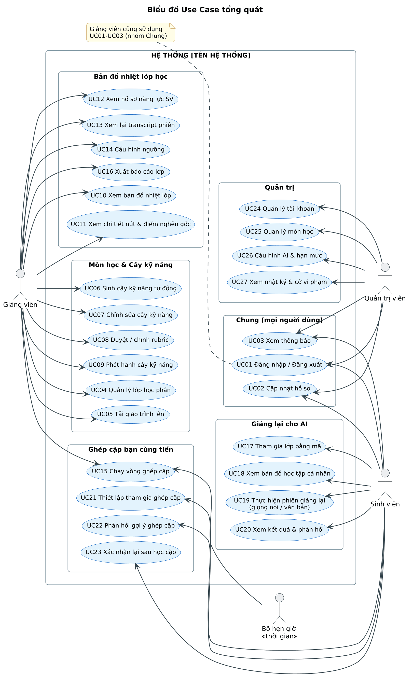
Nguồn: [`12_uc_overall.puml`](../../diagrams/12_uc_overall.puml)
*Hình 4.3. Biểu đồ Use Case tổng quát*

### 4.2.3 Use Case phân rã

#### a) Phân hệ Môn học và Cây kỹ năng

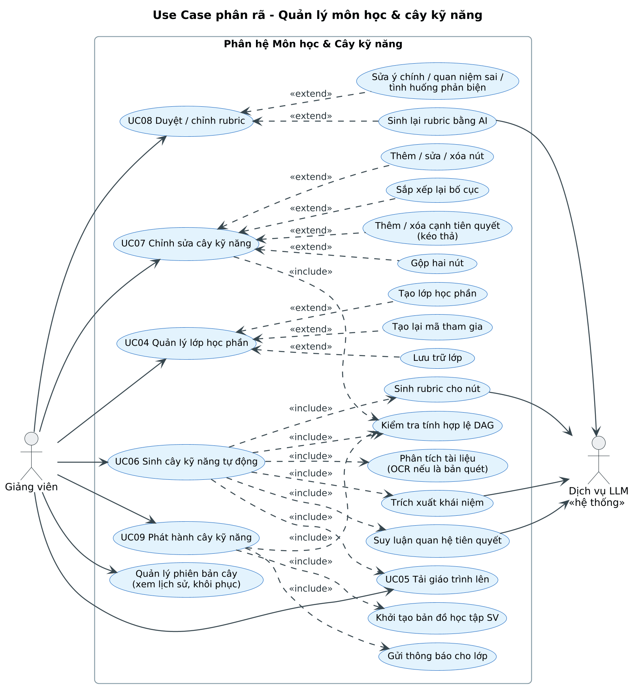
Nguồn: [`13_uc_tree.puml`](../../diagrams/13_uc_tree.puml)
*Hình 4.4. Use Case phân rã – Quản lý môn học và cây kỹ năng*

#### b) Phân hệ Giảng lại cho AI

“Nhập bằng giọng nói” và “Nhập bằng văn bản” là hai Use Case mở rộng (extend) của cả “Giảng giải khái niệm” và “Trả lời câu hỏi phản biện”, nên SV có thể đổi phương thức giữa các lượt trong cùng một phiên.
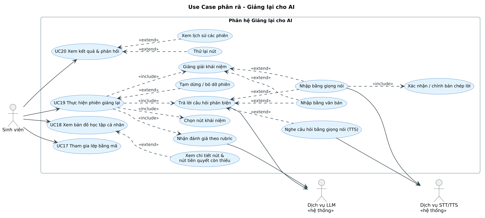
Nguồn: [`14_uc_teach.puml`](../../diagrams/14_uc_teach.puml)
*Hình 4.5. Use Case phân rã – Giảng lại cho AI*

#### c) Phân hệ Bản đồ nhiệt lớp học

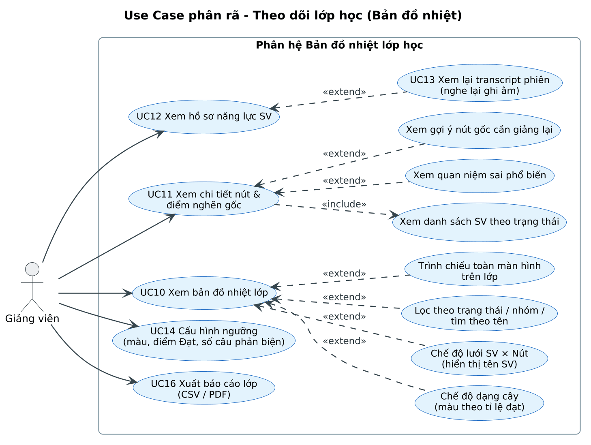
Nguồn: [`15_uc_heatmap.puml`](../../diagrams/15_uc_heatmap.puml)
*Hình 4.6. Use Case phân rã – Theo dõi lớp học (bản đồ nhiệt)*

#### d) Phân hệ Ghép cặp bạn cùng tiến

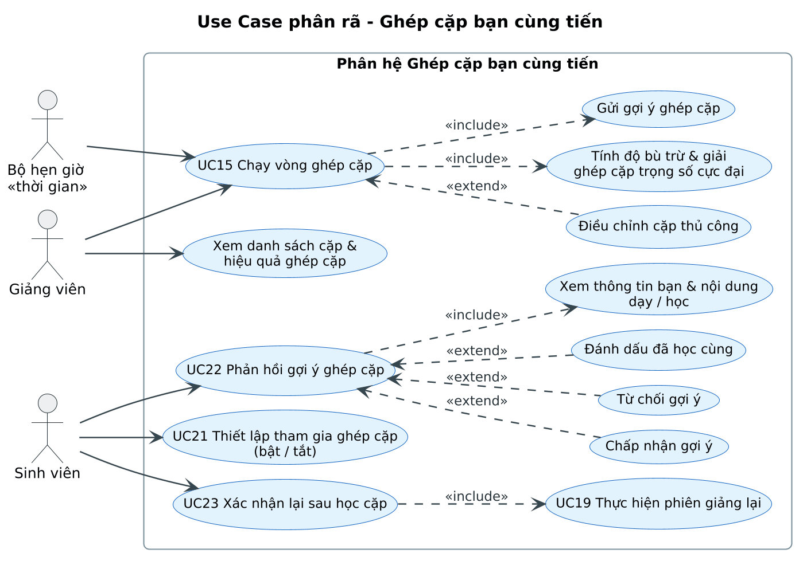
Nguồn: [`16_uc_peer.puml`](../../diagrams/16_uc_peer.puml)
*Hình 4.7. Use Case phân rã – Ghép cặp bạn cùng tiến*

#### e) Phân hệ Tài khoản, Quản trị và chức năng chung

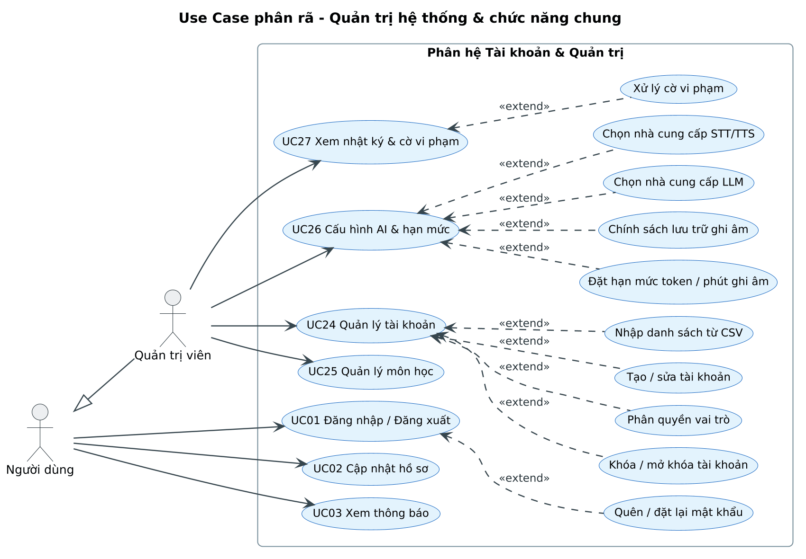
Nguồn: [`17_uc_admin.puml`](../../diagrams/17_uc_admin.puml)
*Hình 4.8. Use Case phân rã – Quản trị hệ thống và chức năng chung*

### 4.2.4 Đặc tả các Use Case chính

*Bảng 4.2. Đặc tả UC06 – Sinh cây kỹ năng tự động*

| Mục | Nội dung |
|---|---|
| Mã – Tên | UC06 – Sinh cây kỹ năng tự động |
| Tác nhân chính | Giảng viên |
| Tác nhân phụ | Dịch vụ LLM |
| Mô tả | Từ giáo trình đã tải lên, hệ thống trích xuất khái niệm, suy luận quan hệ tiên quyết, kiểm tra DAG và sinh rubric cho từng nút, tạo một phiên bản cây ở trạng thái Bản nháp. |
| Kích hoạt | GV nhấn “Tạo cây kỹ năng” sau khi chọn tệp (bao gồm UC05). |
| Tiền điều kiện | GV đã đăng nhập và phụ trách lớp học phần. / Tệp hợp lệ (PDF/DOCX, ≤ 20 MB). |
| Hậu điều kiện | Có một TreeVersion trạng thái DRAFT gồm nút, cạnh, rubric. / SyllabusDocument chuyển PARSED; các đoạn văn bản được lập chỉ mục vector. |
| Luồng sự kiện chính | 1. GV chọn tệp và nhấn “Tạo cây”. / 2. Hệ thống lưu tệp, tạo bản ghi tài liệu, đưa tác vụ vào hàng đợi và trả mã tác vụ. / 3. Hệ thống trích xuất văn bản, nhận diện chương / mục, chia đoạn và tạo embedding. / 4. Với mỗi chương, LLM trích xuất danh sách khái niệm theo JSON Schema. / 5. Hệ thống gộp khái niệm trùng nghĩa. / 6. LLM suy luận quan hệ tiên quyết kèm độ tin cậy cho các cặp ứng viên. / 7. Hệ thống phá chu trình, rút gọn bắc cầu, xếp tầng. / 8. Với mỗi nút, hệ thống truy hồi đoạn giáo trình và LLM sinh rubric có trích dẫn. / 9. Hệ thống lưu bản nháp và thông báo cho GV qua WebSocket. / 10. GV mở trình sửa cây (chuyển sang UC07). |
| Luồng thay thế | 3a. Tài liệu là bản quét: chạy OCR tiếng Việt trước khi nhận diện cấu trúc. / 4a. JSON không hợp lệ: thử lại tối đa 2 lần với thông báo lỗi schema. |
| Ngoại lệ | E1. Tệp sai định dạng / quá dung lượng → báo lỗi 422, kết thúc. / E2. LLM không phản hồi / hết hạn mức → chuyển mô hình dự phòng; nếu vẫn lỗi, tài liệu FAILED, GV được thông báo và có thể thử lại. / E3. Không trích được khái niệm nào → báo GV kiểm tra chất lượng tài liệu. |
| Quy tắc nghiệp vụ | BR-01 |
| Yêu cầu phi chức năng | Thời gian sinh ≤ 3 phút cho đề cương ~30 trang (MT1); hiển thị tiến độ. |
| Tần suất | Vài lần mỗi học kỳ cho mỗi lớp. |

*Bảng 4.3. Đặc tả UC07 & UC09 – Chỉnh sửa và phát hành cây kỹ năng*

| Mục | Nội dung |
|---|---|
| Mã – Tên | UC07 – Chỉnh sửa cây kỹ năng; UC09 – Phát hành cây kỹ năng |
| Tác nhân chính | Giảng viên |
| Tác nhân phụ | — |
| Mô tả | GV hiệu chỉnh cây nháp bằng thao tác kéo thả, duyệt rubric và phát hành cây cho lớp; hệ thống khởi tạo hoặc di chuyển trạng thái thành thạo của SV. |
| Kích hoạt | GV mở trình sửa cây của một phiên bản DRAFT. |
| Tiền điều kiện | Có phiên bản cây ở trạng thái DRAFT / EDITING. |
| Hậu điều kiện | Phiên bản chuyển PUBLISHED, phiên bản cũ ARCHIVED. / Mỗi SV trong lớp có MasteryRecord cho mọi nút; SV được thông báo. |
| Luồng sự kiện chính | 1. GV thêm / sửa / xóa / gộp nút và kéo thả cạnh tiên quyết. / 2. Mỗi thao tác thêm cạnh được kiểm tra chu trình ngay lập tức. / 3. GV duyệt rubric từng nút (có thể sinh lại bằng AI – UC08). / 4. GV nhấn “Phát hành”. / 5. Hệ thống kiểm tra BR-05 (DAG, có nút gốc, rubric đã duyệt). / 6. Hệ thống đánh dấu PUBLISHED, lưu trữ phiên bản cũ. / 7. Hệ thống khởi tạo trạng thái: nút gốc Sẵn sàng, còn lại Khóa. / 8. Hệ thống gửi thông báo cho lớp. |
| Luồng thay thế | 2a. Cạnh mới tạo chu trình: từ chối thao tác, tô đỏ đường đi chu trình. / 7a. Lớp đã có phiên bản trước: ánh xạ nút theo khóa; áp dụng BR-14. |
| Ngoại lệ | E1. Kiểm tra BR-05 thất bại → trả danh sách lỗi, đánh dấu nút lỗi, quay lại bước 1. |
| Quy tắc nghiệp vụ | BR-01, BR-02, BR-05, BR-14 |
| Yêu cầu phi chức năng | Kiểm tra chu trình mỗi thao tác < 200 ms; tự lưu. |
| Tần suất | Nhiều lần trong giai đoạn chuẩn bị môn học. |

*Bảng 4.4. Đặc tả UC19 – Thực hiện phiên giảng lại*

| Mục | Nội dung |
|---|---|
| Mã – Tên | UC19 – Thực hiện phiên giảng lại (giọng nói / văn bản) |
| Tác nhân chính | Sinh viên |
| Tác nhân phụ | Dịch vụ LLM, Dịch vụ STT/TTS |
| Mô tả | SV giảng lại một khái niệm cho AI đóng vai học trò tò mò; AI đặt câu hỏi phản biện; tác tử chấm độc lập đánh giá theo rubric và cập nhật trạng thái thành thạo. |
| Kích hoạt | SV chọn một nút trên bản đồ học tập và nhấn “Bắt đầu giảng”. |
| Tiền điều kiện | SV đã tham gia lớp; cây đã phát hành. / Trạng thái nút là Sẵn sàng, Chưa đạt (hết thời gian chờ) hoặc Cần xác nhận lại. |
| Hậu điều kiện | Có TeachingSession COMPLETED với các SessionTurn và Evaluation. / MasteryRecord cập nhật (Đạt / Chưa đạt); nút con đủ tiên quyết được mở khóa. / Sự kiện “mastery.updated” được phát. |
| Luồng sự kiện chính | 1. SV chọn nút và bắt đầu phiên. / 2. Hệ thống kiểm tra trạng thái, tạo phiên, nạp rubric và ngữ cảnh giáo trình. / 3. AI chào và nhờ SV giảng khái niệm. / 4. SV chọn chế độ nhập và giảng giải (giọng nói hoặc văn bản). / 5. Hệ thống kiểm tra an toàn đầu vào và lưu lượt giảng. / 6. AI phân tích độ bao phủ, chọn chiến lược và đặt một câu hỏi phản biện (đã qua kiểm duyệt đầu ra). / 7. SV trả lời trong thời gian quy định; hệ thống lưu lượt. / 8. Lặp bước 6–7 cho đến khi đủ ý hoặc đạt số câu tối đa. / 9. Tác tử chấm độc lập chấm 5 tiêu chí (≥ 2 lần); hệ thống áp dụng BR-03. / 10. Hệ thống cập nhật trạng thái thành thạo và hiển thị kết quả, gợi ý ôn. |
| Luồng thay thế | 4a. Nhập bằng giọng nói: ghi âm → STT → chuẩn hóa thuật ngữ; nếu độ tin cậy < ngưỡng, SV xem và chỉnh nhỏ bản chép lời trước khi gửi. / 6a. Câu hỏi lộ đáp án: sinh lại (tối đa 2 lần), sau đó dùng câu hỏi mẫu trong ngân hàng tình huống. / 6b. SV bật đọc câu hỏi: hệ thống tổng hợp giọng nói (TTS). / 7a. Hết giờ: ghi nhận câu không trả lời được. / 9a. Hai lần chấm lệch kết luận: chấm lần 3, lấy đa số. |
| Ngoại lệ | E1. Nút đang khóa → báo tiên quyết còn thiếu, kết thúc. / E2. Phát hiện jailbreak / lạc đề → gắn cờ, phản hồi trung lập; ≥ 3 lần → phiên FLAGGED (BR-12). / E3. SV rời phiên > 10 phút → ABANDONED, trạng thái nút trở về như trước. / E4. Dịch vụ STT lỗi → gợi ý chuyển sang nhập văn bản. |
| Quy tắc nghiệp vụ | BR-02, BR-03, BR-04, BR-11, BR-12, BR-13 |
| Yêu cầu phi chức năng | NFR-01, NFR-02, NFR-05, NFR-06 |
| Tần suất | Rất cao: hàng chục phiên đồng thời trong một tiết học. |

*Bảng 4.5. Đặc tả UC10 & UC11 – Xem bản đồ nhiệt và chi tiết điểm nghẽn*

| Mục | Nội dung |
|---|---|
| Mã – Tên | UC10 – Xem bản đồ nhiệt lớp; UC11 – Xem chi tiết nút & điểm nghẽn gốc |
| Tác nhân chính | Giảng viên |
| Tác nhân phụ | — |
| Mô tả | GV theo dõi mức hiểu của cả lớp theo thời gian thực ở hai chế độ (cây màu và lưới SV × Nút có tên), nhận cảnh báo điểm nghẽn gốc và xem chi tiết từng nút. |
| Kích hoạt | GV mở bảng điều khiển của lớp. |
| Tiền điều kiện | GV phụ trách lớp; cây đã phát hành. |
| Hậu điều kiện | GV nắm được nút cần giảng lại và danh sách SV đang kẹt. |
| Luồng sự kiện chính | 1. GV mở bảng điều khiển; hệ thống trả ảnh chụp hiện tại và đăng ký kênh WebSocket của lớp. / 2. Khi có kết quả mới, hệ thống cập nhật màu nút và ô của SV tương ứng. / 3. Khi một nút chuyển ĐỎ, hệ thống truy vết nút gốc và hiển thị cảnh báo. / 4. GV nhấn vào nút để xem chi tiết: SV theo trạng thái (có tên), quan niệm sai phổ biến, nút gốc gợi ý. / 5. GV chọn can thiệp: giảng lại trên lớp hoặc kích hoạt ghép cặp ưu tiên nút đó. |
| Luồng thay thế | 1a. GV chuyển sang chế độ lưới, lọc theo trạng thái hoặc tìm theo tên. / 1b. GV bật chế độ trình chiếu (có thể ẩn tên khi chiếu lên màn hình chung). / 4a. GV nhấn tên SV → xem hồ sơ năng lực (UC12) → transcript (UC13). |
| Ngoại lệ | E1. Mất kết nối WebSocket → tự kết nối lại và tải lại ảnh chụp. |
| Quy tắc nghiệp vụ | BR-06, BR-07 |
| Yêu cầu phi chức năng | NFR-03, NFR-08 |
| Tần suất | Liên tục trong giờ học. |

*Bảng 4.6. Đặc tả UC15 – Chạy vòng ghép cặp*

| Mục | Nội dung |
|---|---|
| Mã – Tên | UC15 – Chạy vòng ghép cặp |
| Tác nhân chính | Giảng viên / Bộ hẹn giờ |
| Tác nhân phụ | — |
| Mô tả | Hệ thống tìm các cặp SV có năng lực bù trừ hai chiều trên toàn lớp và gửi gợi ý học cùng nhau. |
| Kích hoạt | GV nhấn “Ghép cặp” (có thể ưu tiên một nút) hoặc lịch định kỳ. |
| Tiền điều kiện | Cây đã phát hành; có ≥ 2 SV bật ghép cặp. |
| Hậu điều kiện | Có MatchingRound mới và các PeerMatch trạng thái PROPOSED; SV được thông báo. |
| Luồng sự kiện chính | 1. Hệ thống lấy danh sách SV bật ghép cặp, chưa có cặp đang hoạt động. / 2. Hệ thống tính Đạt(A), Biên(A) và trọng số w(A,B) cho mọi cặp. / 3. Hệ thống loại cặp w = 0 và cặp đã ghép trong N ngày. / 4. Hệ thống giải bài toán ghép cặp trọng số cực đại. / 5. Hệ thống chọn tối đa 2 nút mỗi chiều cho từng cặp. / 6. Hệ thống lưu gợi ý (hạn 48 giờ) và gửi thông báo. |
| Luồng thay thế | 4a. Còn SV lẻ: ghép một chiều với một SV đã Đạt nút Biên của bạn đó hoặc đưa vào hàng chờ. / 6a. GV điều chỉnh cặp thủ công trước khi gửi. |
| Ngoại lệ | E1. Không có cặp nào có w > 0 → thông báo GV “chưa có cặp bù trừ phù hợp”. |
| Quy tắc nghiệp vụ | BR-08, BR-09, BR-10 |
| Yêu cầu phi chức năng | Thời gian chạy < 2 giây cho lớp 100 SV. |
| Tần suất | Hằng ngày / theo buổi học. |

*Bảng 4.7. Đặc tả UC22 & UC23 – Phản hồi gợi ý và xác nhận lại sau học cặp*

| Mục | Nội dung |
|---|---|
| Mã – Tên | UC22 – Phản hồi gợi ý ghép cặp; UC23 – Xác nhận lại sau học cặp |
| Tác nhân chính | Sinh viên |
| Tác nhân phụ | — |
| Mô tả | SV chấp nhận hoặc từ chối gợi ý; sau khi học cùng, mỗi SV giảng lại cho AI nút vừa học để xác nhận. |
| Kích hoạt | SV nhận thông báo gợi ý ghép cặp. |
| Tiền điều kiện | Có PeerMatch trạng thái PROPOSED / WAITING_OTHER chưa hết hạn. |
| Hậu điều kiện | PeerMatch chuyển ACCEPTED → STUDIED → VERIFIED / PARTIALLY_VERIFIED / UNVERIFIED, hoặc DECLINED / EXPIRED. |
| Luồng sự kiện chính | 1. SV xem thông tin bạn, nút mình dạy và nút mình học. / 2. SV nhấn “Chấp nhận”; khi cả hai chấp nhận, hệ thống chia sẻ thông tin liên hệ. / 3. Hai bạn học cùng nhau (ngoài hệ thống) và nhấn “Đã học cùng”. / 4. Hệ thống mở yêu cầu xác nhận lại. / 5. Mỗi SV thực hiện phiên giảng lại nút vừa học (bao gồm UC19, đánh dấu is_peer_followup). / 6. Hệ thống cập nhật mục ghép cặp đã xác nhận và trạng thái cặp. |
| Luồng thay thế | 2a. Một bên từ chối → DECLINED; SV về hàng chờ vòng sau. / 5a. Chưa Đạt → giữ Chưa đạt, ưu tiên ghép với bạn khác. |
| Ngoại lệ | E1. Quá 48 giờ chưa đủ hai bên chấp nhận → EXPIRED. / E2. Quá 7 ngày sau khi học cùng chưa xác nhận đủ → PARTIALLY_VERIFIED / UNVERIFIED. |
| Quy tắc nghiệp vụ | BR-09, BR-10 |
| Yêu cầu phi chức năng | Thông báo đến SV trong ≤ 1 phút. |
| Tần suất | Theo mỗi vòng ghép cặp. |

## 4.3 Biểu đồ hoạt động

Các luồng dài được tách thành hai phần (a)/(b) nối bằng điểm nối có ký hiệu (B), (C) để mỗi hình vừa một trang và giữ đủ chi tiết.

### 4.3.1 Sinh và duyệt cây kỹ năng

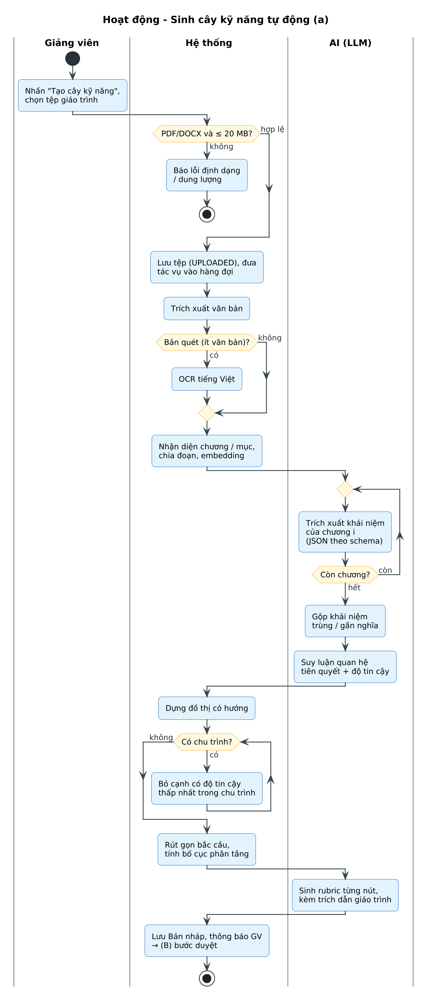
Nguồn: [`18_act_tree_a.puml`](../../diagrams/18_act_tree_a.puml)
*Hình 4.9. Biểu đồ hoạt động – Sinh cây kỹ năng tự động (a)*

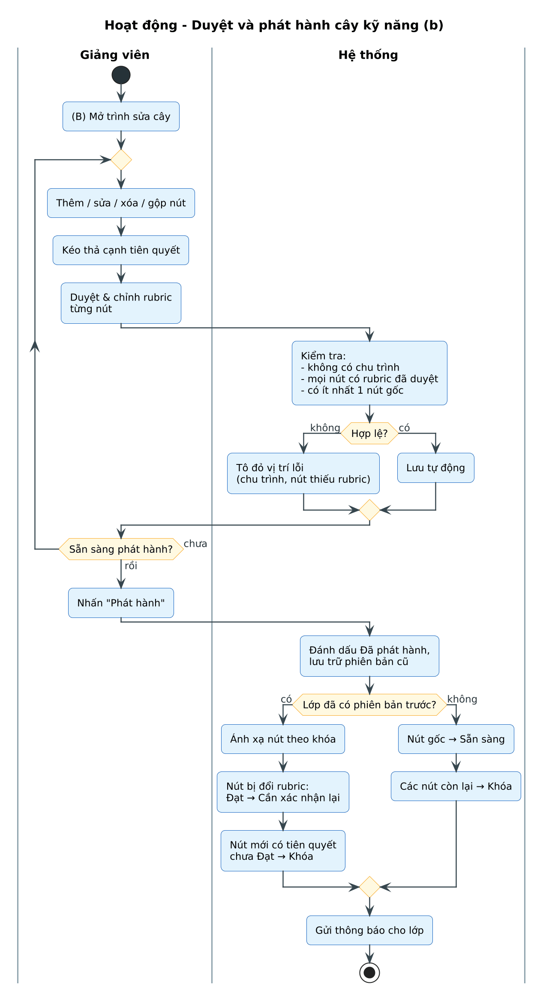
Nguồn: [`19_act_tree_b.puml`](../../diagrams/19_act_tree_b.puml)
*Hình 4.10. Biểu đồ hoạt động – Duyệt và phát hành cây kỹ năng (b)*

### 4.3.2 Phiên giảng lại cho AI

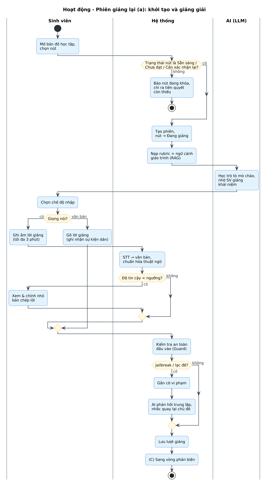
Nguồn: [`20_act_teach_a.puml`](../../diagrams/20_act_teach_a.puml)
*Hình 4.11. Biểu đồ hoạt động – Phiên giảng lại (a): khởi tạo và giảng giải bằng giọng nói / văn bản*

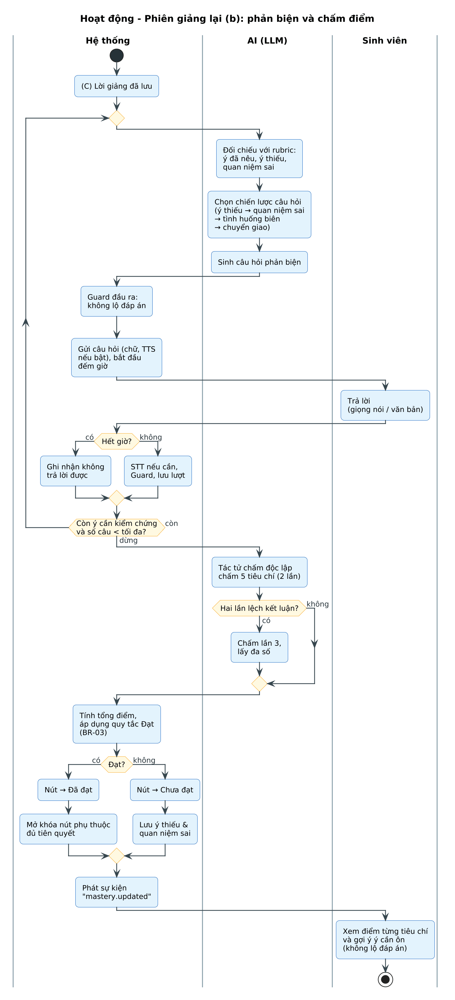
Nguồn: [`21_act_teach_b.puml`](../../diagrams/21_act_teach_b.puml)
*Hình 4.12. Biểu đồ hoạt động – Phiên giảng lại (b): phản biện và chấm điểm*

### 4.3.3 Tổng hợp bản đồ nhiệt và cảnh báo điểm nghẽn

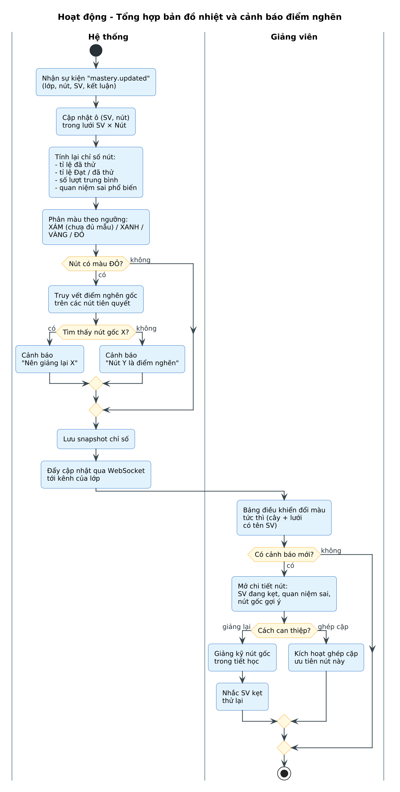
Nguồn: [`22_act_heatmap.puml`](../../diagrams/22_act_heatmap.puml)
*Hình 4.13. Biểu đồ hoạt động – Tổng hợp bản đồ nhiệt và cảnh báo điểm nghẽn*

### 4.3.4 Ghép cặp và xác nhận lại

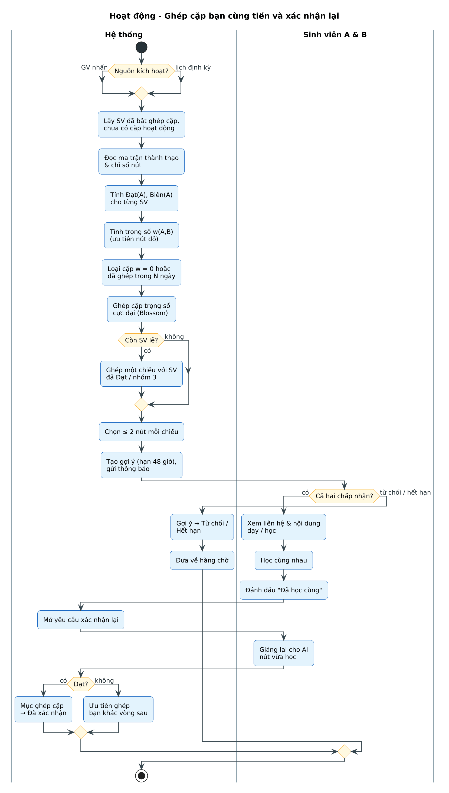
Nguồn: [`23_act_peer.puml`](../../diagrams/23_act_peer.puml)
*Hình 4.14. Biểu đồ hoạt động – Ghép cặp bạn cùng tiến và xác nhận lại*

## 4.4 Biểu đồ tuần tự

Mỗi biểu đồ giới hạn tối đa 8 đối tượng tham gia để dễ đọc; luồng phiên giảng lại được tách thành 4 biểu đồ liên tiếp (1/4 → 4/4). Tên lớp / dịch vụ thống nhất với biểu đồ lớp thiết kế ở mục 5.3.

### 4.4.1 Tải giáo trình và sinh cây kỹ năng

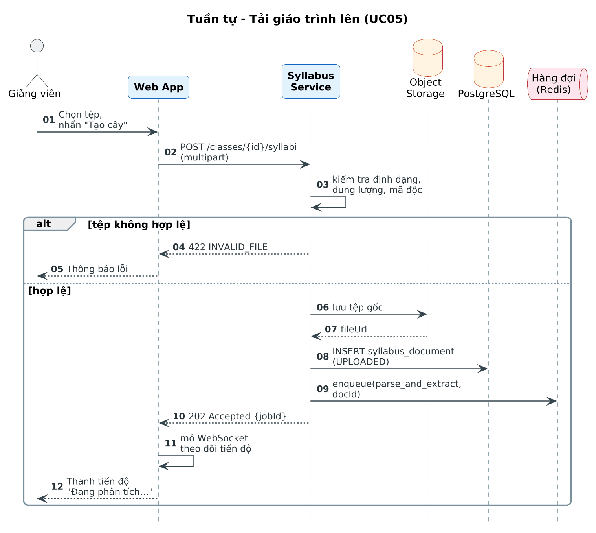
Nguồn: [`24_seq_tree_upload.puml`](../../diagrams/24_seq_tree_upload.puml)
*Hình 4.15. Biểu đồ tuần tự – Tải giáo trình lên (UC05)*

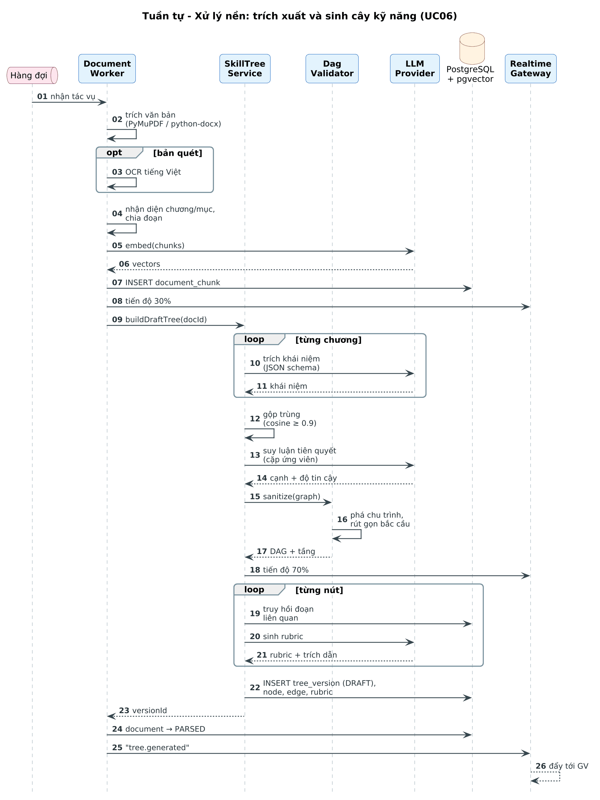
Nguồn: [`25_seq_tree_extract.puml`](../../diagrams/25_seq_tree_extract.puml)
*Hình 4.16. Biểu đồ tuần tự – Xử lý nền trích xuất và sinh cây kỹ năng (UC06)*

### 4.4.2 Chỉnh sửa, duyệt và phát hành cây

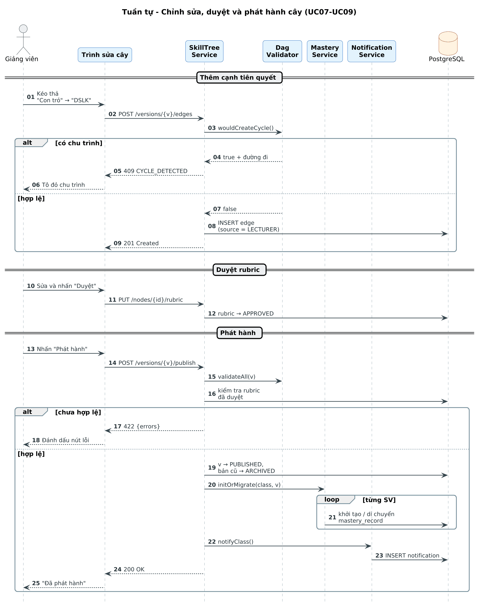
Nguồn: [`26_seq_tree_publish.puml`](../../diagrams/26_seq_tree_publish.puml)
*Hình 4.17. Biểu đồ tuần tự – Chỉnh sửa, duyệt và phát hành cây (UC07–UC09)*

### 4.4.3 Phiên giảng lại cho AI

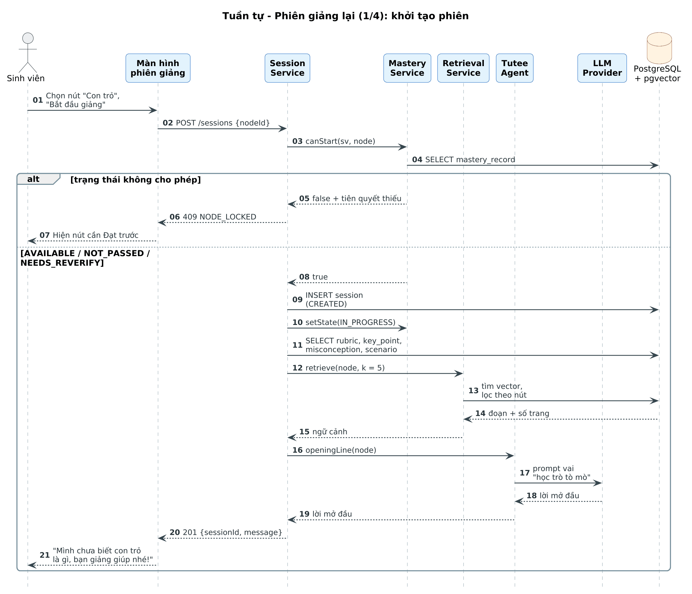
Nguồn: [`27_seq_teach_init.puml`](../../diagrams/27_seq_teach_init.puml)
*Hình 4.18. Biểu đồ tuần tự – Phiên giảng lại (1/4): khởi tạo phiên*

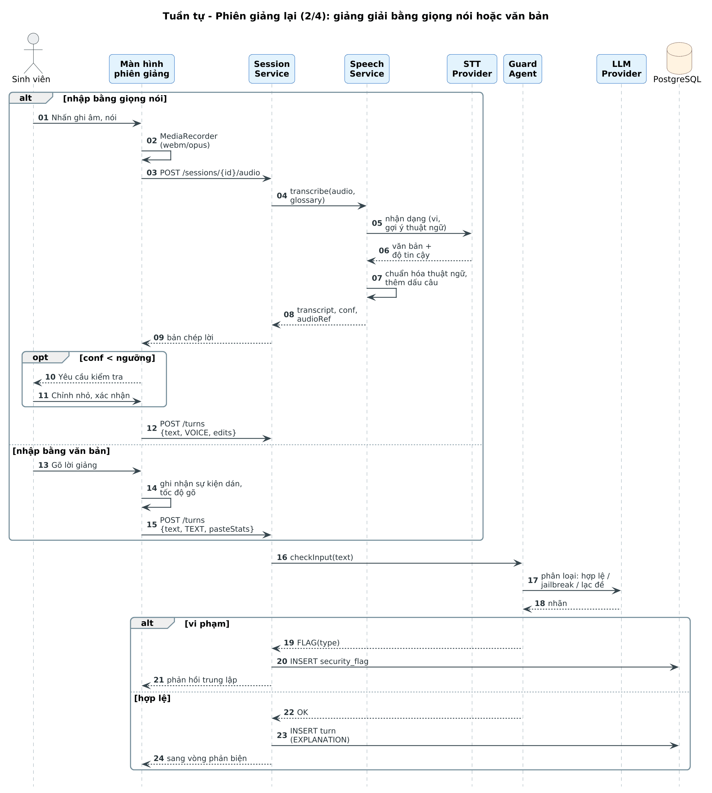
Nguồn: [`28_seq_teach_input.puml`](../../diagrams/28_seq_teach_input.puml)
*Hình 4.19. Biểu đồ tuần tự – Phiên giảng lại (2/4): giảng giải bằng giọng nói hoặc văn bản*

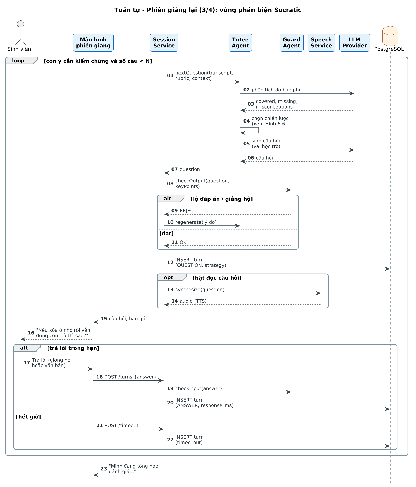
Nguồn: [`29_seq_teach_challenge.puml`](../../diagrams/29_seq_teach_challenge.puml)
*Hình 4.20. Biểu đồ tuần tự – Phiên giảng lại (3/4): vòng phản biện Socratic*

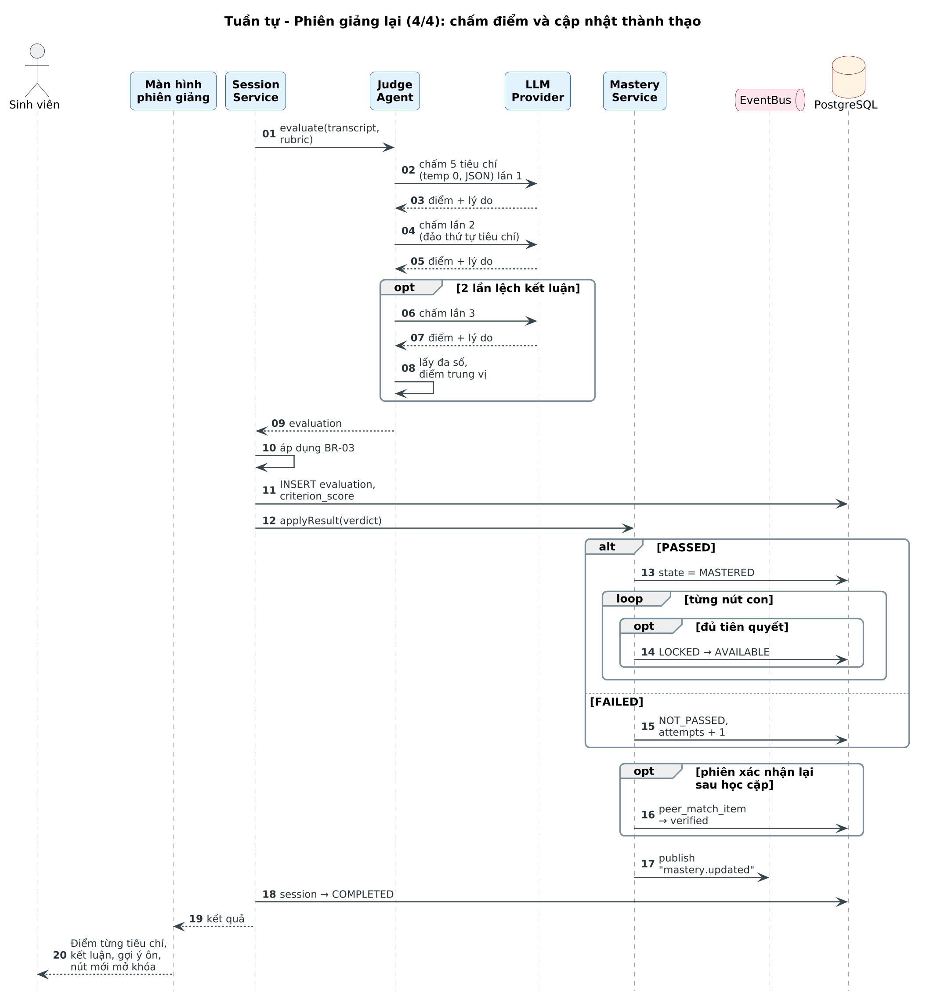
Nguồn: [`30_seq_teach_eval.puml`](../../diagrams/30_seq_teach_eval.puml)
*Hình 4.21. Biểu đồ tuần tự – Phiên giảng lại (4/4): chấm điểm và cập nhật thành thạo*

### 4.4.4 Cập nhật bản đồ nhiệt thời gian thực

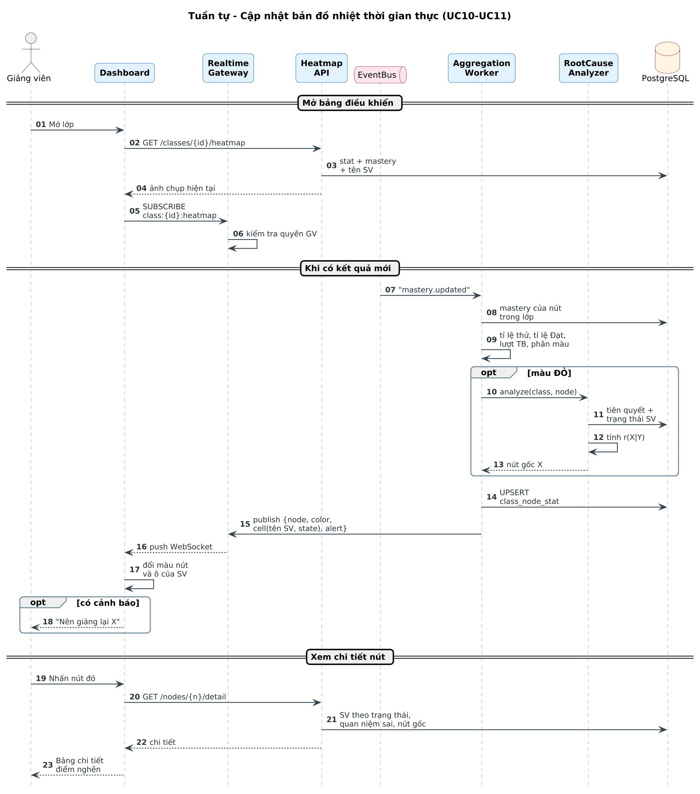
Nguồn: [`31_seq_heatmap.puml`](../../diagrams/31_seq_heatmap.puml)
*Hình 4.22. Biểu đồ tuần tự – Cập nhật bản đồ nhiệt thời gian thực và xem chi tiết nút*

### 4.4.5 Ghép cặp và xác nhận lại

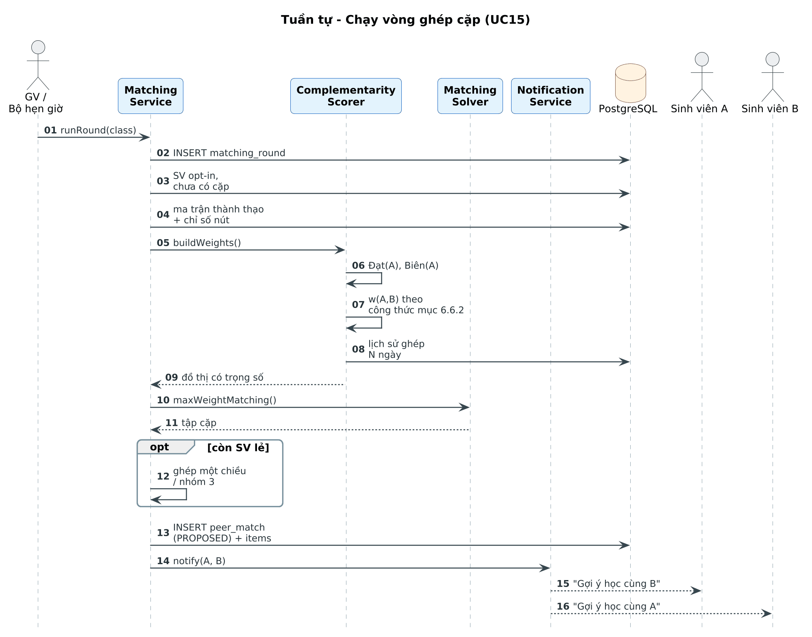
Nguồn: [`32_seq_peer_round.puml`](../../diagrams/32_seq_peer_round.puml)
*Hình 4.23. Biểu đồ tuần tự – Chạy vòng ghép cặp (UC15)*

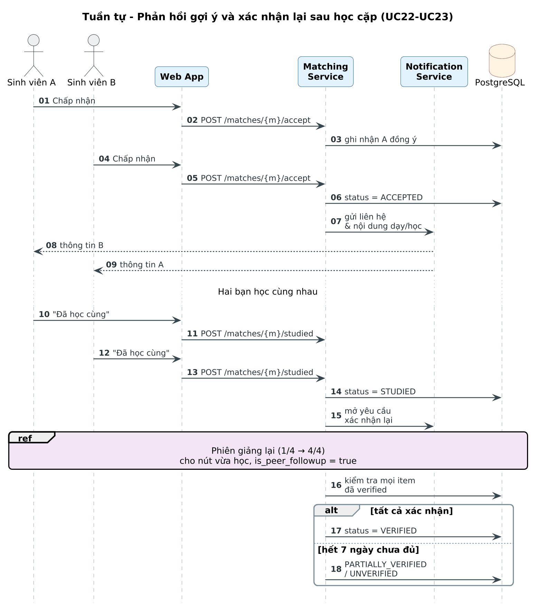
Nguồn: [`33_seq_peer_verify.puml`](../../diagrams/33_seq_peer_verify.puml)
*Hình 4.24. Biểu đồ tuần tự – Phản hồi gợi ý và xác nhận lại (UC22–UC23)*

## 4.5 Biểu đồ trạng thái

### 4.5.1 Trạng thái thành thạo của một nút đối với một sinh viên

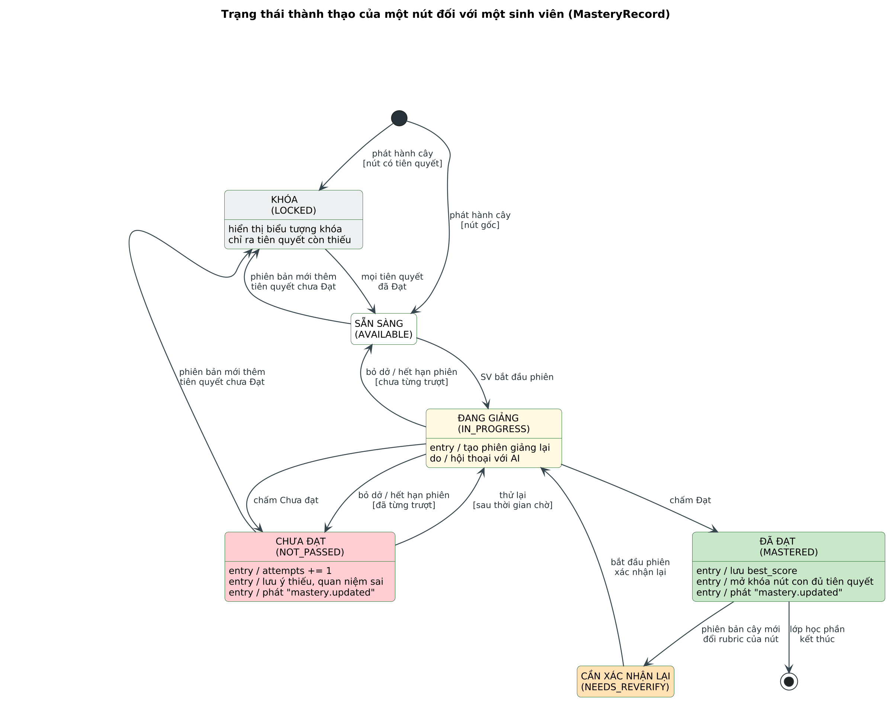
Nguồn: [`34_st_mastery.puml`](../../diagrams/34_st_mastery.puml)
*Hình 4.25. Biểu đồ trạng thái – MasteryRecord*

*Bảng 4.8. Bảng chuyển trạng thái của MasteryRecord*

| Trạng thái hiện tại | Sự kiện | Điều kiện | Trạng thái mới | Hành động |
|---|---|---|---|---|
| (khởi tạo) | Phát hành cây | Nút không có tiên quyết | AVAILABLE | — |
| (khởi tạo) | Phát hành cây | Nút có tiên quyết | LOCKED | — |
| LOCKED | Tiên quyết vừa Đạt | Mọi tiên quyết đã MASTERED | AVAILABLE | Thông báo nút mới mở |
| AVAILABLE | Bắt đầu phiên | — | IN_PROGRESS | Tạo TeachingSession |
| IN_PROGRESS | Chấm xong | Verdict = PASSED | MASTERED | Lưu best_score; mở khóa nút con; phát sự kiện |
| IN_PROGRESS | Chấm xong | Verdict = FAILED | NOT_PASSED | attempts + 1; phát sự kiện |
| IN_PROGRESS | Bỏ dở / hết hạn | Chưa từng trượt | AVAILABLE | Phiên ABANDONED |
| IN_PROGRESS | Bỏ dở / hết hạn | Đã từng trượt | NOT_PASSED | Phiên ABANDONED |
| NOT_PASSED | Bắt đầu phiên | Hết thời gian chờ (BR-11) | IN_PROGRESS | Tạo phiên mới |
| MASTERED | Phát hành phiên bản mới | Rubric nút thay đổi | NEEDS_REVERIFY | Thông báo SV |
| NEEDS_REVERIFY | Bắt đầu phiên | — | IN_PROGRESS | Tạo phiên xác nhận |
| AVAILABLE / NOT_PASSED | Phát hành phiên bản mới | Thêm tiên quyết chưa Đạt | LOCKED | — |

### 4.5.2 Trạng thái phiên giảng lại

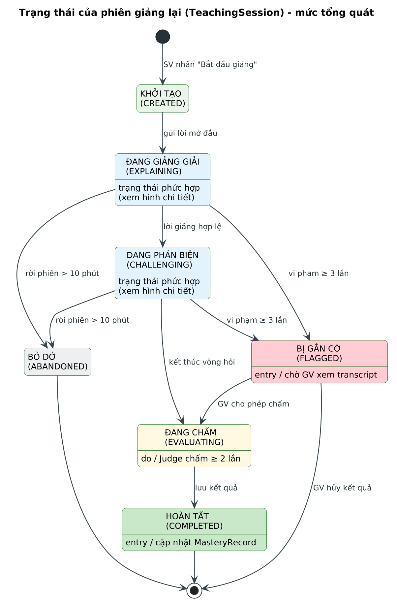
Nguồn: [`35_st_session.puml`](../../diagrams/35_st_session.puml)
*Hình 4.26. Biểu đồ trạng thái – TeachingSession (mức tổng quát)*

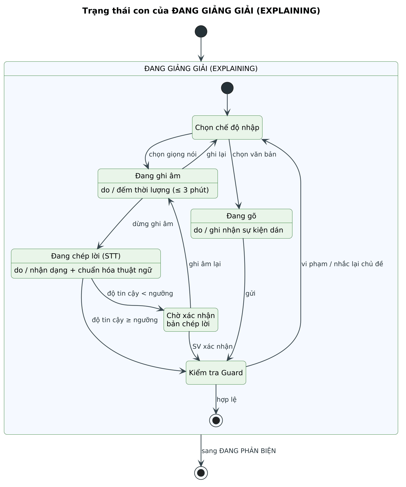
Nguồn: [`36_st_session_explain.puml`](../../diagrams/36_st_session_explain.puml)
*Hình 4.27. Trạng thái con của ĐANG GIẢNG GIẢI (giọng nói / văn bản)*

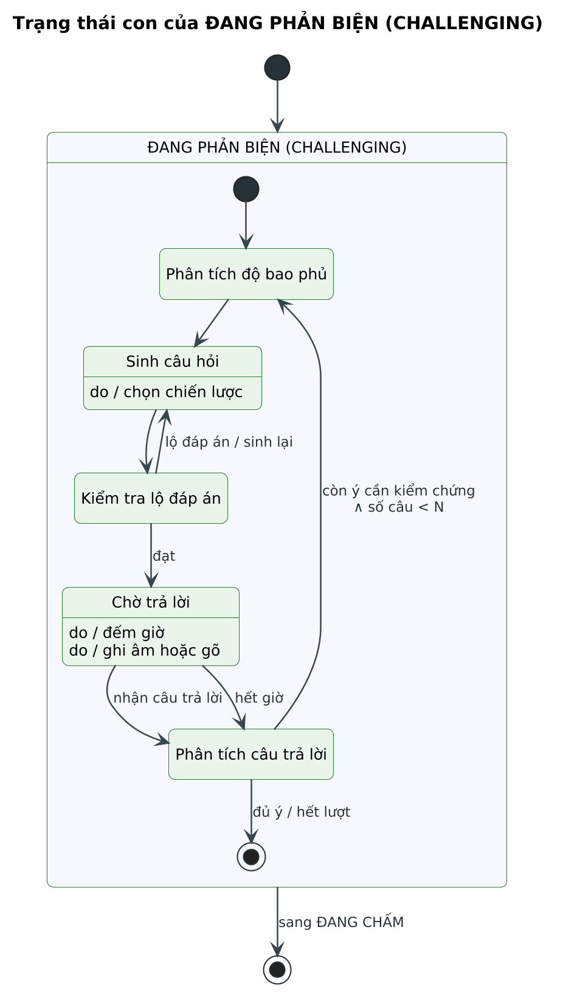
Nguồn: [`37_st_session_challenge.puml`](../../diagrams/37_st_session_challenge.puml)
*Hình 4.28. Trạng thái con của ĐANG PHẢN BIỆN*

### 4.5.3 Vòng đời phiên bản cây kỹ năng

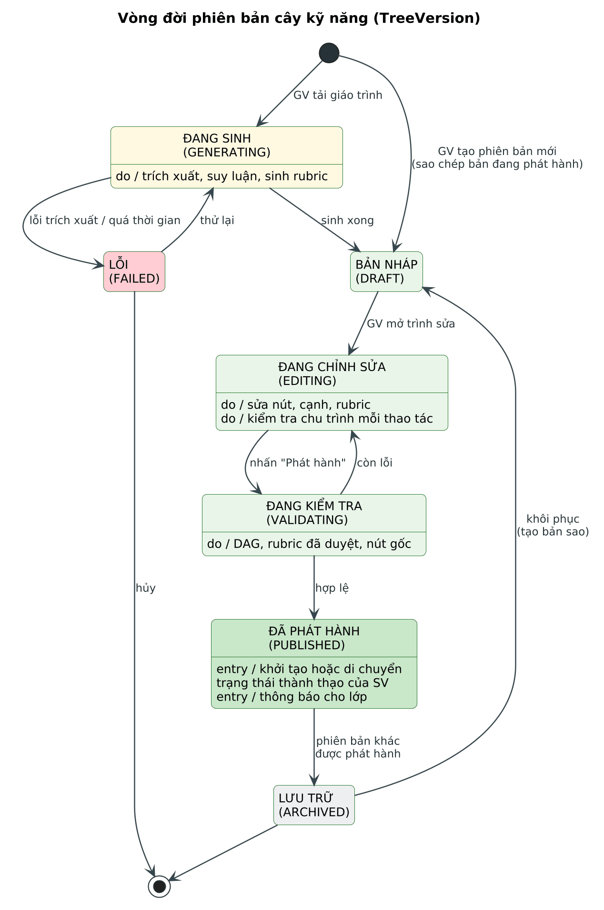
Nguồn: [`38_st_tree.puml`](../../diagrams/38_st_tree.puml)
*Hình 4.29. Biểu đồ trạng thái – TreeVersion*

### 4.5.4 Trạng thái gợi ý ghép cặp

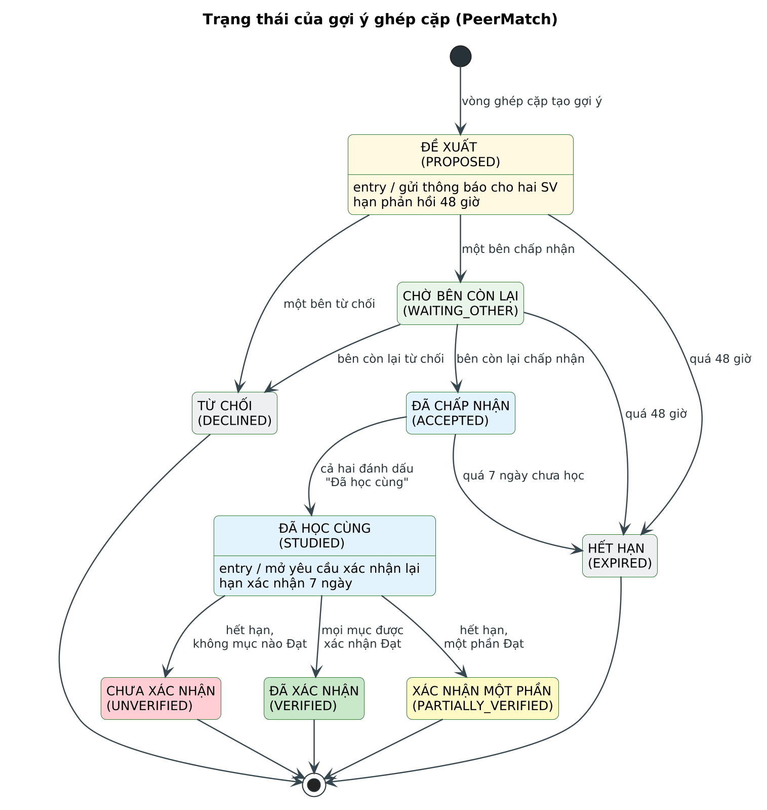
Nguồn: [`39_st_match.puml`](../../diagrams/39_st_match.puml)
*Hình 4.30. Biểu đồ trạng thái – PeerMatch*

## 4.6 Biểu đồ lớp mức phân tích

Biểu đồ lớp được trình bày theo hai mức: (1) tổng quan quan hệ giữa toàn bộ 30 lớp (ẩn thuộc tính); (2) bốn biểu đồ chi tiết theo nhóm, có đầy đủ thuộc tính, phương thức và bội số. Các lớp ghi «tham chiếu» là lớp đã được mô tả chi tiết ở nhóm khác.
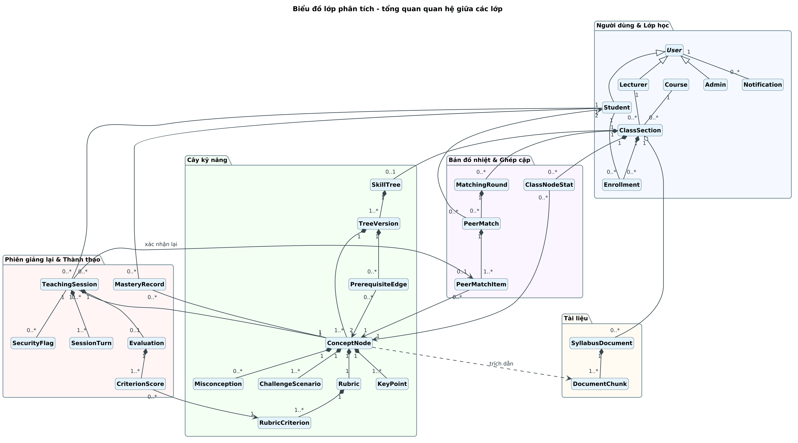
Nguồn: [`40_cls_overview.puml`](../../diagrams/40_cls_overview.puml)
*Hình 4.31. Biểu đồ lớp phân tích – tổng quan quan hệ giữa các lớp*

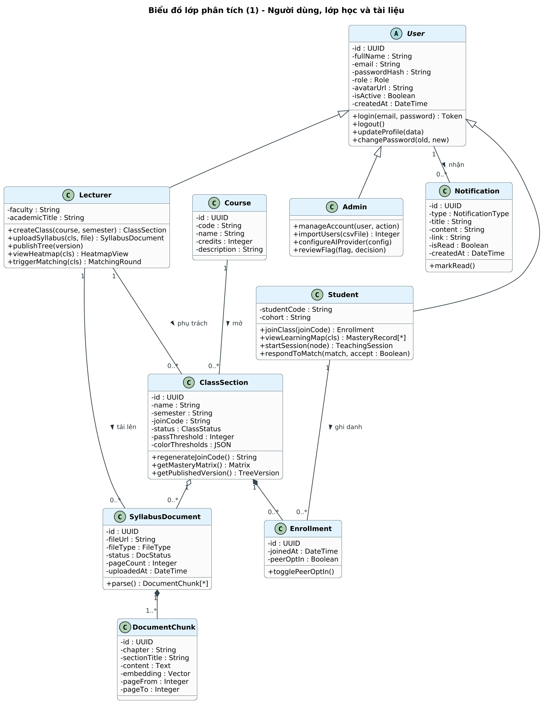
Nguồn: [`41_cls_users.puml`](../../diagrams/41_cls_users.puml)
*Hình 4.32. Biểu đồ lớp phân tích (1) – Người dùng, lớp học và tài liệu*

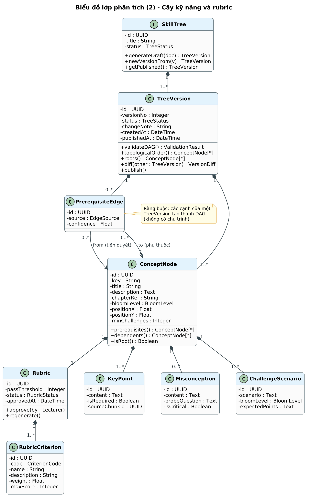
Nguồn: [`42_cls_tree.puml`](../../diagrams/42_cls_tree.puml)
*Hình 4.33. Biểu đồ lớp phân tích (2) – Cây kỹ năng và rubric*

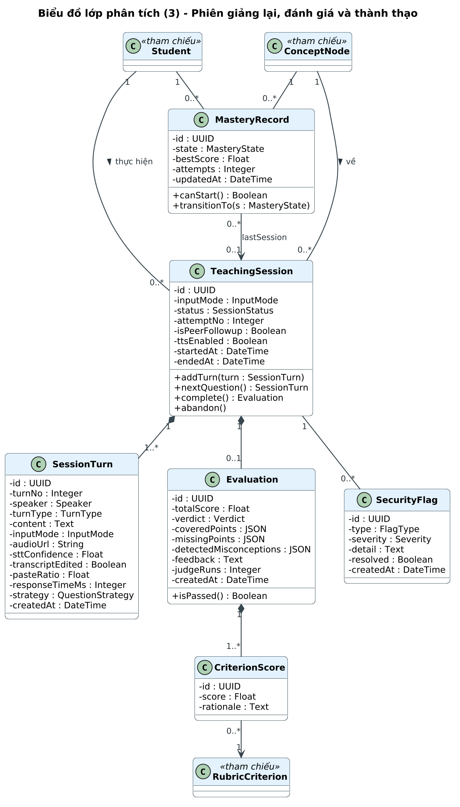
Nguồn: [`43_cls_session.puml`](../../diagrams/43_cls_session.puml)
*Hình 4.34. Biểu đồ lớp phân tích (3) – Phiên giảng lại, đánh giá và thành thạo*

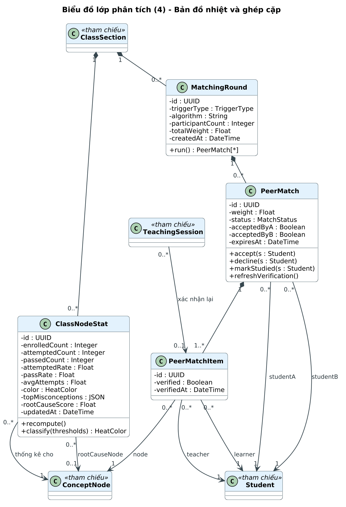
Nguồn: [`44_cls_peer.puml`](../../diagrams/44_cls_peer.puml)
*Hình 4.35. Biểu đồ lớp phân tích (4) – Bản đồ nhiệt và ghép cặp*

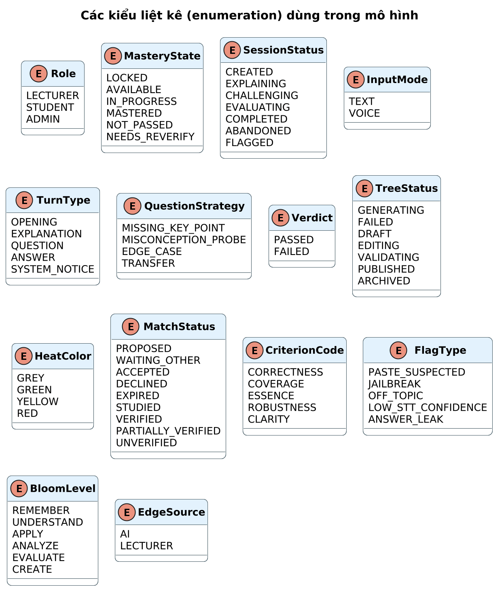
Nguồn: [`45_cls_enums.puml`](../../diagrams/45_cls_enums.puml)
*Hình 4.36. Các kiểu liệt kê (enumeration) dùng trong mô hình*

*Bảng 4.9. Ý nghĩa các lớp thực thể*

| Lớp | Ý nghĩa |
|---|---|
| User / Lecturer / Student / Admin | Người dùng và ba vai trò |
| Course, ClassSection, Enrollment | Môn học, lớp học phần, ghi danh (kèm cờ tham gia ghép cặp) |
| SyllabusDocument, DocumentChunk | Tệp giáo trình và các đoạn văn bản đã lập chỉ mục vector |
| SkillTree, TreeVersion | Cây kỹ năng của lớp và các phiên bản của nó |
| ConceptNode, PrerequisiteEdge | Nút khái niệm và cạnh tiên quyết (from → to) |
| Rubric, RubricCriterion, KeyPoint, Misconception, ChallengeScenario | Bộ tiêu chí chấm, ý chính, quan niệm sai và tình huống phản biện của một nút |
| TeachingSession, SessionTurn | Một phiên giảng lại và từng lượt hội thoại (văn bản / giọng nói) |
| Evaluation, CriterionScore | Kết quả chấm và điểm từng tiêu chí |
| MasteryRecord | Một ô của ma trận thành thạo (SV, nút) |
| ClassNodeStat | Chỉ số tổng hợp theo cột của ma trận (bản đồ nhiệt) |
| MatchingRound, PeerMatch, PeerMatchItem | Vòng ghép cặp, cặp SV, nội dung dạy – học của từng chiều |
| SecurityFlag, Notification | Cờ vi phạm và thông báo |

### 4.6.1 Phân tích theo mẫu Boundary – Control – Entity

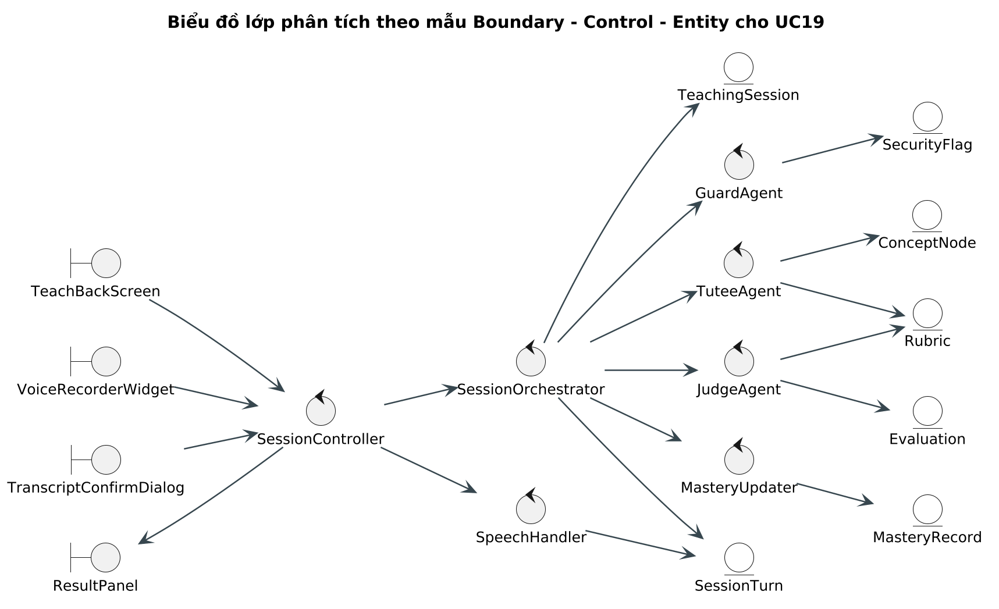
Nguồn: [`46_cls_bce.puml`](../../diagrams/46_cls_bce.puml)
*Hình 4.37. Biểu đồ lớp phân tích theo mẫu Boundary – Control – Entity cho UC19*
