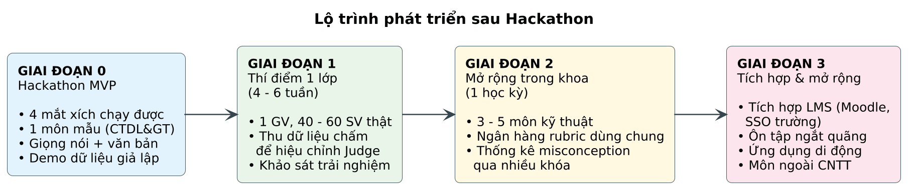

# CHƯƠNG 8. KẾT LUẬN VÀ HƯỚNG PHÁT TRIỂN

## 8.1 Kết quả đạt được

*Bảng 8.1. Đối chiếu kết quả với mục tiêu (điền sau thực nghiệm)*

| Mã | Mục tiêu | Chỉ tiêu | Kết quả |
|---|---|---|---|
| MT1 | Sinh cây kỹ năng tự động | F1 cạnh ≥ 0,70 | […] |
| MT2 | Phiên giảng lại giọng nói + văn bản | p95 ≤ 5 / 8 giây | […] |
| MT3 | Chấm đáng tin cậy | κ ≥ 0,60 | […] |
| MT4 | Chống gian lận | ≥ 90% bị chặn | […] |
| MT5 | Bản đồ nhiệt thời gian thực | ≤ 3 giây | […] |
| MT6 | Ghép cặp hiệu quả | ≥ 50% cặp được xác nhận | […] |

## 8.2 Hạn chế

- Chất lượng cây và rubric phụ thuộc chất lượng giáo trình đầu vào và vẫn cần GV duyệt.
- LLM-as-a-Judge vẫn có thể sai; cần dữ liệu hiệu chỉnh thật từ lớp học để đạt độ tin cậy cao.
- Nhận dạng giọng nói giảm chính xác trong môi trường ồn hoặc khi dùng nhiều thuật ngữ tiếng Anh.
- Hiệu quả sư phạm (điểm thi, mức độ hiểu lâu dài) cần thí điểm dài hạn để kiểm chứng.

## 8.3 Rủi ro dự án và phương án

*Bảng 8.2. Bảng rủi ro dự án*

| Rủi ro | Khả năng | Ảnh hưởng | Giảm thiểu |
|---|---|---|---|
| Chấm thiếu nhất quán | TB | Cao | Rubric neo, chấm nhiều lần, hiệu chỉnh với GV, GV xem lại phiên có cờ |
| SV gian lận / jailbreak | Cao | Cao | 6 lớp phòng vệ (mục 5.6.3) |
| Cây sinh tự động sai | TB | TB | Trình sửa kéo thả, bắt buộc duyệt trước phát hành |
| Chi phí API vượt dự kiến | TB | TB | Hạn mức, cache, mô hình nhỏ hơn cho Guard |
| SV ngại bị hiển thị tên | TB | TB | Minh bạch khi tham gia, chế độ trình chiếu ẩn tên, SV không thấy kết quả của nhau |
| GV không có thời gian duyệt | TB | Cao | Ngân hàng rubric dùng chung, sinh rubric chất lượng cao kèm trích dẫn |
| Trễ tiến độ Hackathon | Cao | Cao | Ưu tiên M trước, khóa phạm vi, kịch bản demo có dữ liệu giả lập |

## 8.4 Hướng phát triển

Nguồn: [`86_roadmap.puml`](../../diagrams/86_roadmap.puml)
*Hình 8.1. Lộ trình phát triển sau Hackathon*

- Thí điểm với một lớp thật để thu dữ liệu hiệu chỉnh và đo hiệu quả sư phạm.
- Ngân hàng rubric và thống kê quan niệm sai dùng chung giữa các lớp, các khóa.
- Tích hợp LMS / SSO của trường; ôn tập ngắt quãng dựa trên ma trận thành thạo; ứng dụng di động.
- Mở rộng sang các môn ngoài khối kỹ thuật có cấu trúc tiên quyết.
