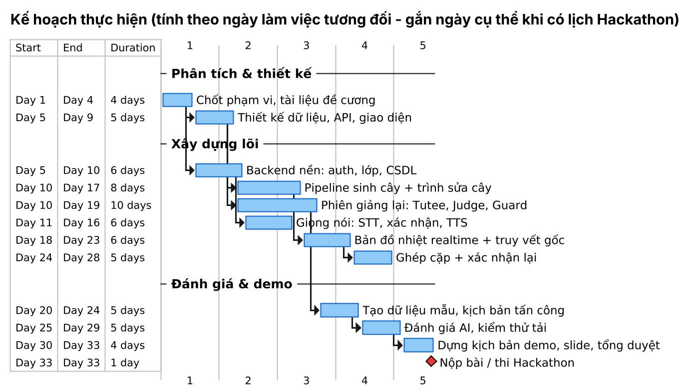

# PHỤ LỤC C. KẾ HOẠCH THỰC HIỆN VÀ PHÂN CÔNG

Nguồn: [`87_gantt_plan.puml`](../../diagrams/87_gantt_plan.puml)
*Hình C.1. Kế hoạch thực hiện (Gantt, tính theo ngày làm việc tương đối)*

*Bảng C.1. Phân công công việc (điền tên thành viên)*

| Thành viên | Vai trò | Phụ trách |
|---|---|---|
| [Thành viên 1] | Trưởng nhóm, AI | Tác tử Tutee / Judge / Guard, prompt, đánh giá AI |
| [Thành viên 2] | Backend | API, CSDL, worker, WebSocket, thuật toán DAG / ghép cặp / truy vết |
| [Thành viên 3] | Frontend | Trình sửa cây, dashboard bản đồ nhiệt, phiên giảng lại, ghi âm |
| [Thành viên 4] | Giọng nói, kiểm thử, tài liệu | STT / TTS, kiểm thử tải, kịch bản demo, tài liệu và slide |
