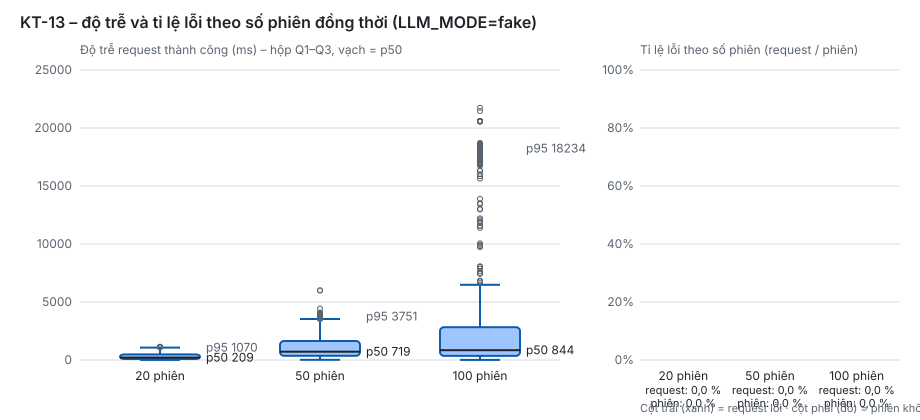

# Kết quả đánh giá – perf (KT-13)

- Ngày chạy: 2026-10-26T14:41:49+00:00 · Commit: `6286cd7` · Người chạy: Claude (làm thay Quyền)
- Cấu hình: **LLM_MODE=fake** (độ trễ LLM thật **chưa tính**, chỉ đo hạ tầng API + PostgreSQL + Redis) · model=fake · dữ liệu: tài khoản SV tạo riêng cho lần chạy, lớp mẫu `CTDL2026`
- Máy: Windows 11, Intel64 Family 6 Model 186 Stepping 2, GenuineIntel, 20 luồng CPU; Docker 29.8.2 cấp 20 CPU, 7.6 GiB RAM
- Đích: `http://localhost` · kịch bản mỗi phiên: đăng nhập → tạo phiên → lời giảng → trả lời phản biện tới COMPLETED → xem kết quả. Các phiên của một mức được thả cùng lúc. Timeout request 60.0 s.

| Số phiên | Request | p50 (ms) | p95 (ms) | p99 (ms) | max (ms) | p50 / p95 bỏ đăng nhập (ms) | Lỗi request | Phiên lỗi | Phiên p50 (s) | Phiên p95 (s) | Thông lượng (req/s) |
|---:|---:|---:|---:|---:|---:|---:|---:|---:|---:|---:|---:|
| 20 | 140 | 209 | 1070 | 1130 | 1151 | 184 / 586 | 0 (0,0 %) | 0/20 (0,0 %) | 2.38 | 2.51 | 53.8 |
| 50 | 350 | 719 | 3751 | 4065 | 6004 | 625 / 2667 | 0 (0,0 %) | 0/50 (0,0 %) | 8.57 | 9.55 | 36.2 |
| 100 | 700 | 844 | 18234 | 20589 | 21742 | 667 / 6254 | 0 (0,0 %) | 0/100 (0,0 %) | 25.33 | 26.32 | 26.4 |

Chỉ tiêu Bảng 7.3: p95 ≤ 5 s. 20 phiên: Đạt, 50 phiên: Đạt, 100 phiên: Chưa đạt (chỉ hạ tầng, LLM fake).

## Theo endpoint (p50 / p95 ms, số lỗi)

| Số phiên | Endpoint | Số request | p50 | p95 | Lỗi |
|---:|---|---:|---:|---:|---:|
| 20 | `GET /sessions/{id}/result` | 20 | 33 | 110 | 0 |
| 20 | `POST /auth/login` | 20 | 985 | 1134 | 0 |
| 20 | `POST /sessions` | 20 | 552 | 644 | 0 |
| 20 | `POST /sessions/{id}/turns` | 80 | 184 | 457 | 0 |
| 50 | `GET /sessions/{id}/result` | 50 | 107 | 224 | 0 |
| 50 | `POST /auth/login` | 50 | 3537 | 4067 | 0 |
| 50 | `POST /sessions` | 50 | 1899 | 3873 | 0 |
| 50 | `POST /sessions/{id}/turns` | 200 | 625 | 1298 | 0 |
| 100 | `GET /sessions/{id}/result` | 100 | 164 | 670 | 0 |
| 100 | `POST /auth/login` | 100 | 17541 | 20589 | 0 |
| 100 | `POST /sessions` | 100 | 4239 | 17443 | 0 |
| 100 | `POST /sessions/{id}/turns` | 400 | 649 | 2879 | 0 |

## Lỗi gặp

- Không có phiên lỗi.

Số liệu thô: [`perf_raw.json`](perf_raw.json). Chạy lại: xem đầu `evals/perf/load_sessions.py`.
## Nhận xét (viết tay sau lần chạy – chạy lại script sẽ ghi đè file, nhớ chép lại mục này)

- **Đây là LLM_MODE=fake**: Tutee / Judge / Guard trả JSON mẫu tức thì ⇒ số trên chỉ là hạ tầng (FastAPI 4 worker,
  PostgreSQL, Redis, nginx). Độ trễ LLM thật **chưa tính**; phần "20 phiên dùng model thật + chi phí token" của thẻ chưa chạy.
- Hai lần chạy liên tiếp (tài khoản mới mỗi lần) dao động lớn ở mức 50: lần 1 p95 = 15,1 s (login p95 15,4 s), lần 2 p95 = 3,8 s.
  Mức 100 ổn định hơn: p95 17,8 s / 18,2 s. Bảng trên là lần 2; JSON thô cũng là lần 2.
  Lần 1 (tag `kt13a`): 20 phiên p50 252 / p95 2 003 ms; 50 phiên p50 645 / p95 15 093 ms; 100 phiên p50 1 240 / p95 17 819 ms; 0 % lỗi.
- **Nút thắt: `POST /auth/login`** (Argon2id mặc định 64 MiB / lần băm, chạy trong handler đồng bộ) – chiếm phần lớn p95
  và kéo chậm cả `POST /sessions`. Bỏ đăng nhập, p95 ở 100 phiên còn 6,3 s. Đã mở #159 (P1).
- Khi dựng lại stack, nginx giữ IP cũ của `api` ⇒ 502 tới khi `docker compose restart nginx`. Đã mở #160 (P2).
- Nghi ngờ đo: máy chủ chỉ còn ~0,7 GB RAM trống lúc chạy (nhiều container của phiên khác cùng chạy) nên số có thể xấu
  hơn trên VM demo riêng; công cụ tải chạy cùng máy với stack. Cần chạy lại trên VM demo (C2-04) trước khi điền Bảng 7.3.
- Không có lỗi HTTP / timeout ở cả 3 mức (timeout request 60 s); mọi phiên đi tới COMPLETED sau 4 lượt (1 giảng + 3 phản biện).
